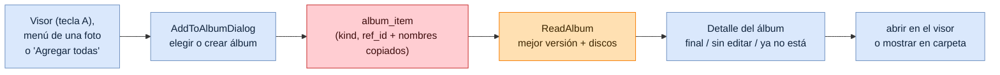
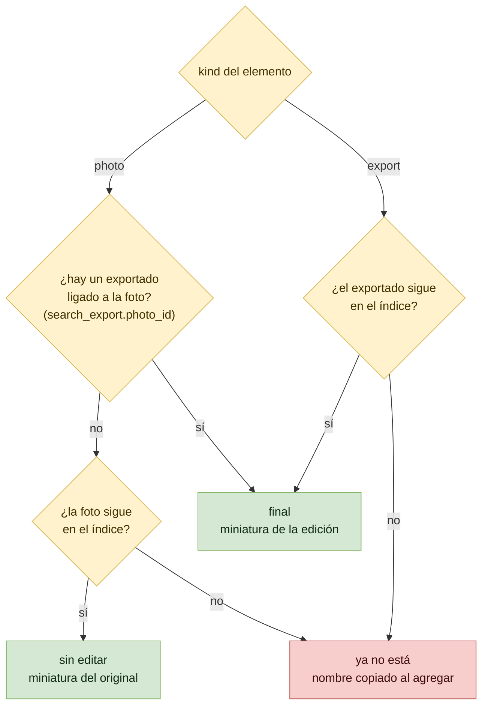
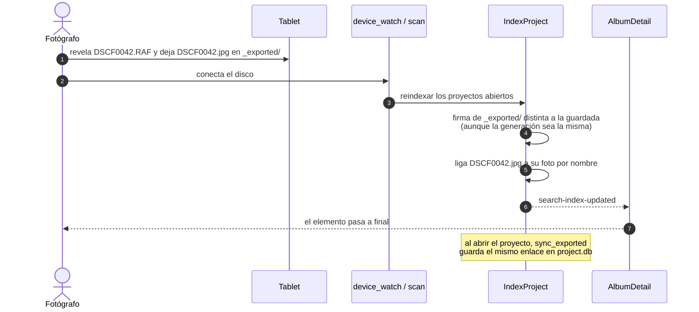
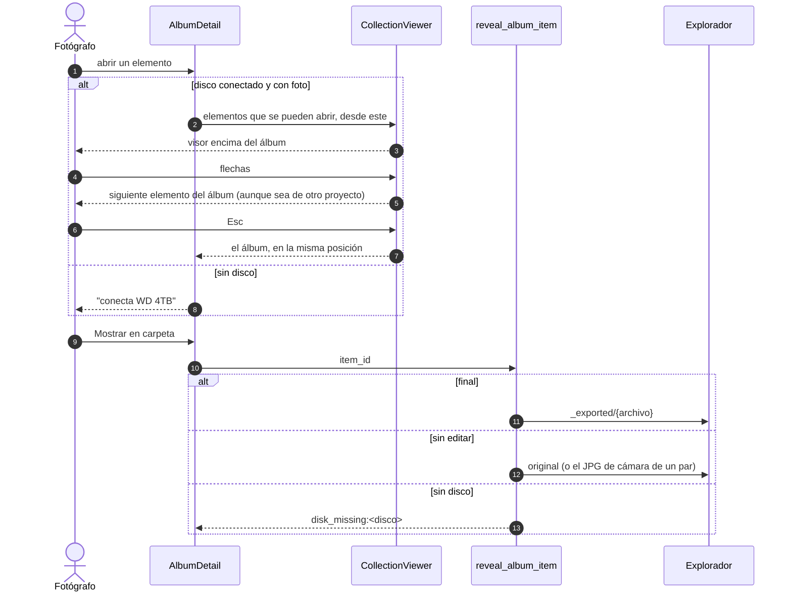

# Flujo: Álbumes

Lumik Desktop · Linux · Windows · macOS · Android (y la futura app de tablet, vía `lumik-core`)

Un álbum junta fotos de varios proyectos y discos para curarlas juntas (una convocatoria, un
portafolio). Vive en la base del equipo (`lumik.db`), no en los discos, y sus elementos se
referencian por id: una **foto** (`photo.id`) o un **exportado** de `_exported/`
(`uuid5(project_id/nombre)`, el mismo del respaldo y del portal). Cada elemento muestra su mejor
versión, que se resuelve al leer el álbum contra el índice de búsqueda: un álbum armado con
originales pasa solo a mostrar las ediciones cuando se exportan.

## Vista general

## 1. Mejor versión de cada elemento

Un disco desconectado no hace que un elemento "ya no esté": el índice conserva las filas de sus
proyectos. El aviso de discos faltantes cuenta, por disco, los elementos cuyo proyecto no está
abierto.

El índice incluye los archivos de `_exported/` (`search_export`), ligados a su foto por
`photo.jpg_path` o, si todavía no hay enlace, por nombre con la misma regla que `sync_exported`
(stem sin extensión, sin distinguir mayúsculas). La miniatura de la edición solo se rehace si
cambia el tamaño o la fecha del archivo.

## 1b. Exportado hecho fuera de Lumik

## 2. Abrir y mostrar en carpeta

## Código

| Pieza | Archivo |
|-------|---------|
| Id y extensiones de los exportados | `crates/lumik-core/src/domain/exported.rs` |
| Tablas `album`, `album_item`, `search_export` | `crates/lumik-core/src/db/global_schema.sql` |
| Álbumes: operaciones y mejor versión | `crates/lumik-core/src/db/albums.rs` |
| Indexar `_exported/` | `crates/lumik-core/src/application/use_cases/index_project.rs` |
| Leer un álbum, agregar resultados | `crates/lumik-core/src/application/use_cases/albums.rs` |
| Comandos y mostrar en carpeta | `src-tauri/src/commands/albums.rs` |
| Lista, detalle, agregar y reemplazar | `src/pages/Albums/` |
| Visor que recorre el álbum o los resultados | `src/pages/Collection/CollectionViewer.tsx` |
