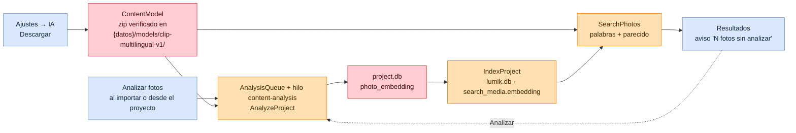
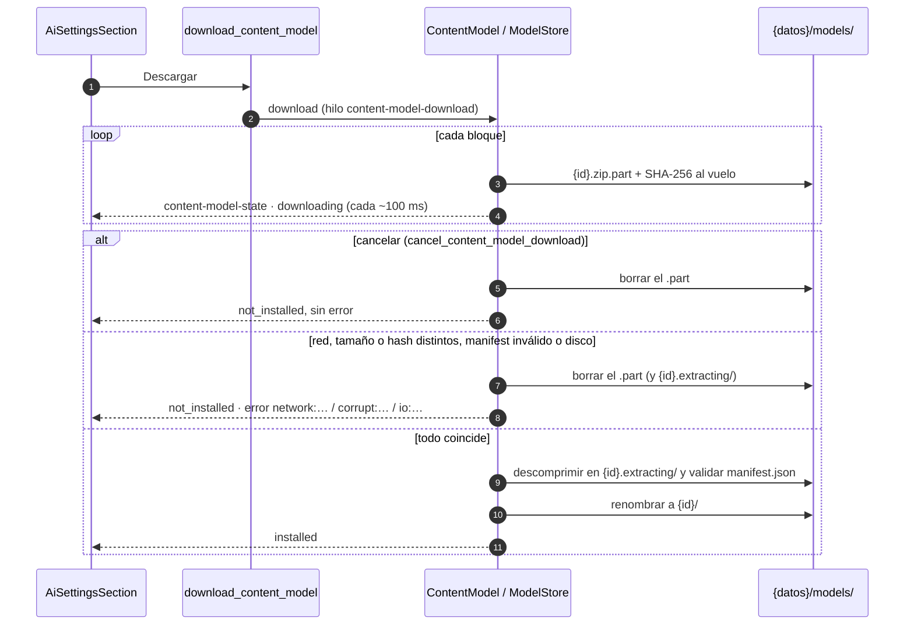
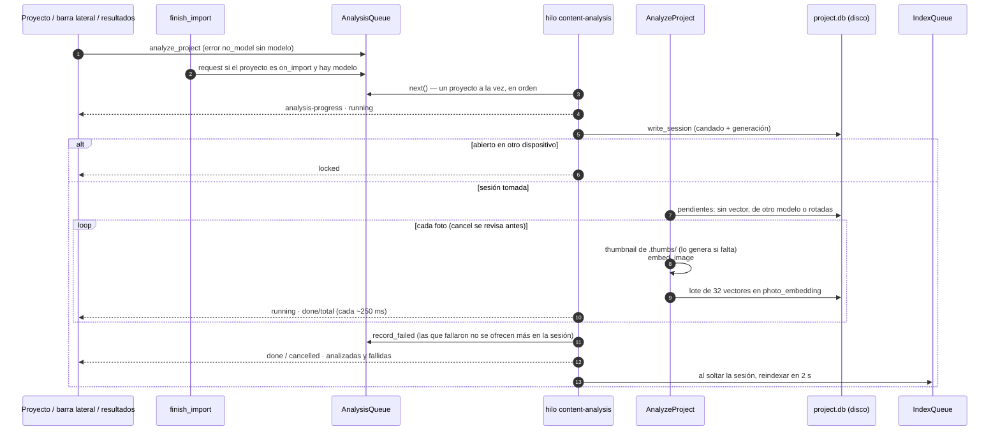
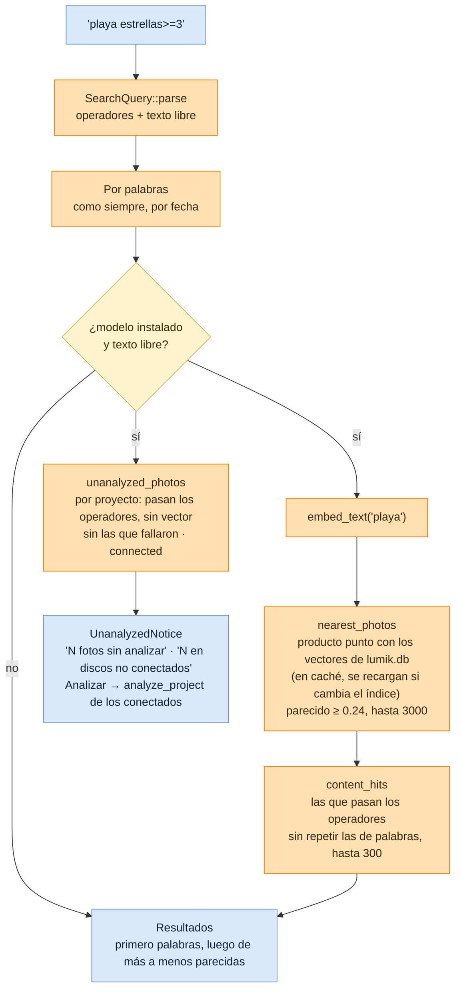

# Flujo: Búsqueda por contenido

Lumik Desktop · Linux · Windows · macOS · Android (y la futura app de tablet, vía `lumik-core`)

Con el modelo instalado, el texto libre de la búsqueda trae también las fotos que **se parecen** a lo
escrito ("niños en la playa", "kids on the beach"), aunque no tengan esas palabras en sus tags.
El modelo es opcional y se descarga desde Ajustes → IA. Cada foto se analiza una vez: su vector se
guarda en el `project.db` de su disco, así que otro equipo con el mismo disco lo reusa sin volver a
analizarla. Todo corre en el equipo, sin red, salvo la descarga del modelo.

## Vista general

## 1. Descargar el modelo

El paquete (`image.onnx`, `text.onnx`, `tokenizer.json`, `manifest.json` y las licencias) es el
asset del release `model-clip-multilingual-v1`; su URL, tamaño y SHA-256 están en
`domain::embedding::CLIP_MULTILINGUAL`. `LUMIK_MODEL_URL` (`https://` o `file://`) descarga otro,
p. ej. uno armado en local con `tools/models/`.

"Borrar" (`delete_content_model`) quita la carpeta del modelo, pero no los vectores de los proyectos:
siguen en cada `project.db` y sirven si se vuelve a descargar.

## 2. Analizar las fotos de un proyecto

"Detener" (`stop_project_analysis`) levanta la bandera de cancelación: lo hecho se queda y el resto
sigue pendiente. Expulsar el disco (`eject_device`) detiene igual el análisis de sus proyectos y
espera hasta 10 s a que suelte la base.

El modo de cada proyecto (`on_import` u `on_demand`) va en "Editar proyecto"; los proyectos nuevos
toman el de Ajustes → IA (`default_analysis_mode`).

## 3. Buscar por contenido

Los vectores viven en `lumik.db`, así que también salen las fotos de discos no conectados (con
"conecta…", como en la búsqueda por palabras). Sin modelo, o con solo operadores, la búsqueda es la
de siempre.

## Código

| Pieza | Archivo |
|-------|---------|
| Paquete del modelo (URL, tamaño, hash), modo de análisis | `crates/lumik-core/src/domain/embedding.rs` |
| Carga del modelo, preprocesado y tokenizer (`ort`, feature `embeddings`) | `crates/lumik-core/src/embedding.rs` |
| Analizar un proyecto | `crates/lumik-core/src/application/use_cases/analyze_project.rs` |
| Cola de análisis y fotos fallidas | `crates/lumik-core/src/application/analysis_queue.rs` |
| Vectores al índice | `crates/lumik-core/src/application/use_cases/index_project.rs` |
| Búsqueda por parecido y sin analizar | `crates/lumik-core/src/application/use_cases/search_photos.rs`, `db/search_index.rs` |
| Descarga, verificación e instalación | `src-tauri/src/infrastructure/content_model.rs` |
| Comandos del modelo y del análisis | `src-tauri/src/commands/content_model.rs`, `commands/analysis.rs` |
| Hilo de análisis, análisis tras importar, al expulsar | `src-tauri/src/commands.rs` (`spawn_analysis_worker`), `commands/import_cmd.rs`, `commands/device.rs` |
| Ajustes → IA y modo | `src/pages/AiSettingsSection.tsx`, `src/components/AnalysisModeSelect.tsx` |
| Proyecto, barra lateral y resultados | `ProjectDetailHeader.tsx`, `EditProjectModal.tsx`, `src/components/Sidebar.tsx`, `src/pages/Search/PhotoSearchResults.tsx` |
| Empaquetar el modelo | `tools/models/build_clip_multilingual.py` |
