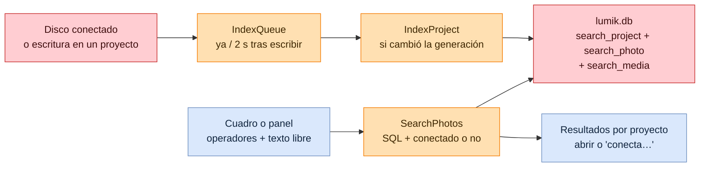
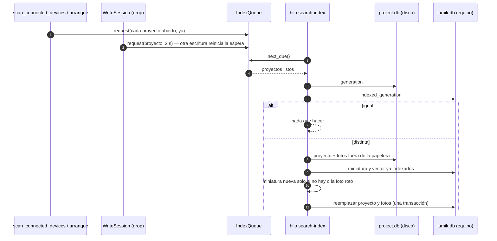
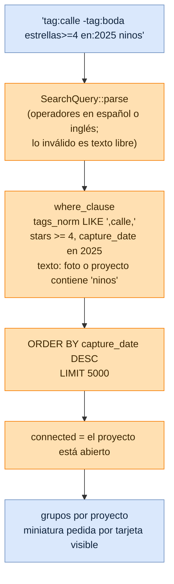

# Flujo: Búsqueda de fotos

Lumik Desktop · Linux · Windows · macOS · Android (y la futura app de tablet, vía `lumik-core`)

La búsqueda cruza todos los proyectos que ha visto el equipo, aunque su disco no esté conectado.
Para eso cada equipo guarda un **índice** en su base global (`lumik.db`): una copia de las fotos de
cada proyecto (tags, estrellas, color, fechas, cámara, lente y estado) y, en una tabla aparte
(`search_media`) para que las búsquedas recorran filas chicas, una miniatura de 128 px y el vector
de la foto.
La fuente de verdad sigue siendo cada `project.db`; el índice se puede borrar y se reconstruye al
conectar los discos.

## Vista general

## 1. Mantener el índice al día

Lo que otro equipo cambió en el disco se recoge al conectarlo, porque su generación es distinta.
Eliminar un proyecto lo quita del índice; desconectar su disco no.

## 2. Buscar

La búsqueda vive en el buscador del dashboard (`SearchBox`): al escribir filtra proyectos por nombre;
Enter o el panel avanzado cambian el grid por los resultados de fotos (`PhotoSearchResults`), con
"Volver a proyectos". Mientras el texto parece llevar operadores no se filtran proyectos.

El panel de búsqueda avanzada no tiene lógica propia: al abrirse pide `parse_search_query` del
cuadro, y al buscar pide `format_search_query` para escribir los operadores en el idioma de la app.

Abrir un resultado con su disco conectado muestra el visor encima de los resultados
(`CollectionViewer`): las flechas recorren los resultados con disco conectado, aunque crucen
proyectos, y Esc vuelve a los resultados en la misma posición. Sin disco, se muestra la miniatura y
qué disco conectar.

El texto libre busca hoy por coincidencia. Con `semantic-search` pasará a ordenar por parecido entre
las candidatas que dejen los operadores, usando la columna `embedding` que ya existe.

## Código

| Pieza | Archivo |
|-------|---------|
| Consulta (operadores, ida y vuelta) | `crates/lumik-core/src/domain/search.rs` |
| Tablas del índice | `crates/lumik-core/src/db/global_schema.sql` |
| Escritura y consulta del índice | `crates/lumik-core/src/db/search_index.rs` |
| Indexar un proyecto | `crates/lumik-core/src/application/use_cases/index_project.rs` |
| Buscar | `crates/lumik-core/src/application/use_cases/search_photos.rs` |
| Cola de reindexado | `crates/lumik-core/src/application/index_queue.rs` |
| Hilo, pedidos al escanear y tras escribir | `src-tauri/src/commands.rs` |
| Miniatura de 128 px | `src-tauri/src/infrastructure/imaging.rs` (`index_thumbnail`) |
| Comandos | `src-tauri/src/commands/search.rs` |
| Buscador, resultados y panel | `src/pages/Search/SearchBox.tsx`, `PhotoSearchResults.tsx`, `AdvancedSearchPanel.tsx` |
