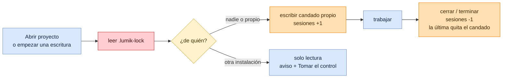
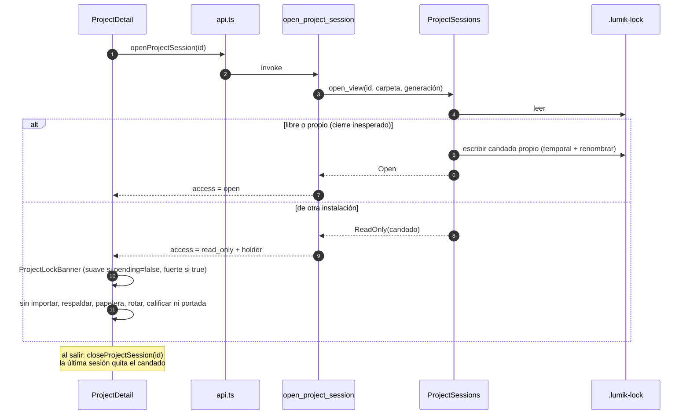
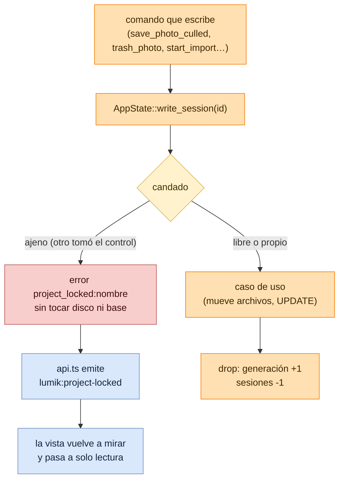
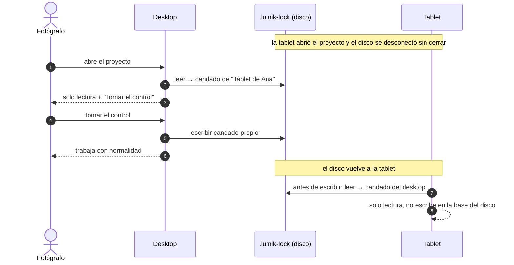

# Flujo: Candado del proyecto

Lumik Desktop · Linux · Windows · macOS · Android

Un proyecto vive en el disco externo y el disco se mueve entre equipos. Para que dos instalaciones
de Lumik no modifiquen el mismo proyecto sin saberlo, quien trabaja en él deja un candado en su
carpeta: `.lumik-lock`, un JSON con la instalación (`install_id`, `install_name`), la hora de
inicio (`since`), la generación de `project.db` y `pending` (cambios que aún no llegaron al disco,
para el modo espejado de la tablet; en desktop siempre es `false`).

El candado se toma por **sesión de trabajo**: la vista del proyecto abierta o una operación que
escribe en él (importar, aprobar, calificar, papelera, respaldar, editar, archivar…). Las sesiones
se cuentan por proyecto: la primera escribe el candado y la última lo quita. Listar en el dashboard
solo lo lee.

## Vista general

## 1. Abrir la vista del proyecto

## 2. Escrituras: cada comando revisa el candado

`delete_project` y `edit_project` cierran la base para borrar o mover la carpeta, así que no
sostienen una sesión: solo comprueban que el candado no sea ajeno (`ensure_not_locked`). Al mover
la carpeta, el candado viaja dentro y `ProjectSessions::relocate` actualiza la ruta.

## 3. Tomar el control

Desde el dashboard no hay vista abierta: editar, archivar o eliminar un proyecto ajeno muestra
`TakeControlDialog`; al confirmar se toma el control y se suelta enseguida, así el proyecto queda
libre y la acción sigue con normalidad.

Expulsar un disco suelta primero los candados propios de sus proyectos y después cierra sus bases.
Cerrar la app suelta todos.

## Código

| Pieza | Archivo |
|-------|---------|
| Modelo y estados del candado | `src-tauri/src/domain/lock.rs` |
| Sesiones por proyecto | `src-tauri/src/application/project_session.rs` |
| Puerto `ProjectLockStore` | `src-tauri/src/application/ports.rs` |
| Escritura atómica y nombre del equipo | `src-tauri/src/infrastructure/lock.rs` |
| `write_session`, `ensure_not_locked` | `src-tauri/src/commands.rs` |
| `open_project_session`, `close_project_session`, `take_project_control` | `src-tauri/src/commands/project.rs` |
| Identidad de la instalación | `src-tauri/src/db/queries.rs` (`install_identity`), `commands/settings.rs` |
| Expulsión | `src-tauri/src/application/use_cases/eject_device.rs` |
| Aviso y diálogo | `src/components/ProjectLockNotice.tsx` |
| Vista en solo lectura | `src/pages/Project/ProjectDetail/ProjectDetail.tsx`, `PhotoDetail.tsx` |
| Marca en el dashboard | `packages/ui/.../ProjectCard.tsx` (`lockedBy`), `src/pages/Project/Projects/Projects.tsx` |
