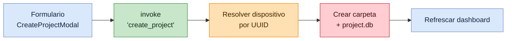
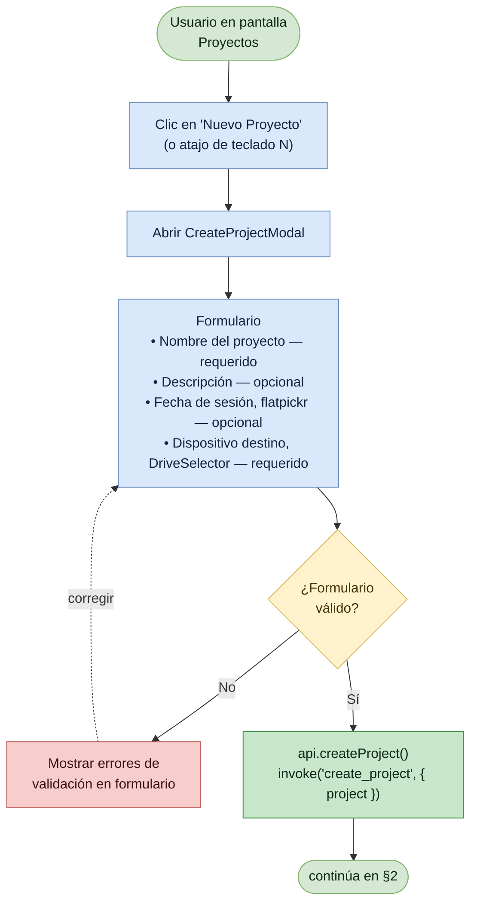
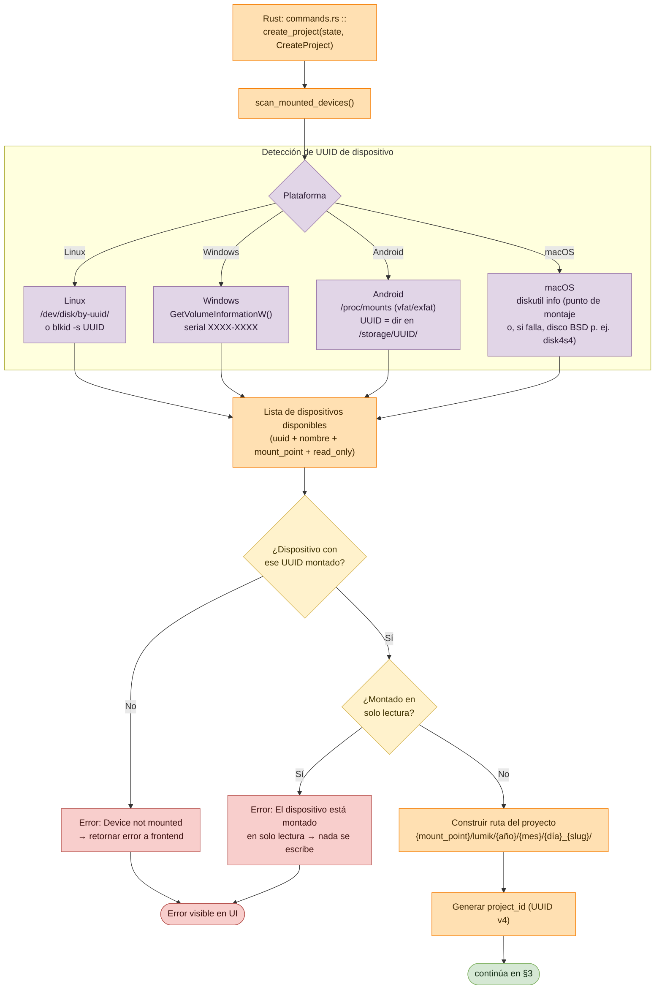
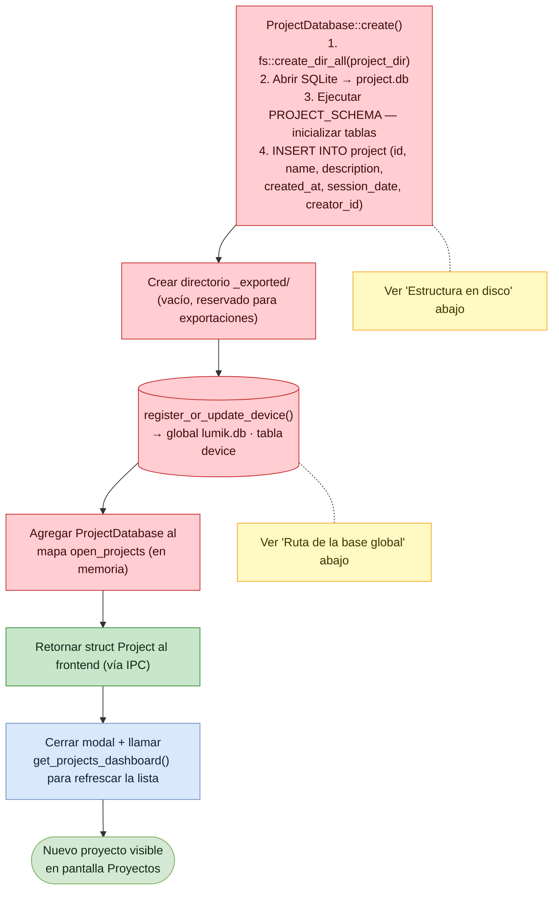

# Flujo: Crear Proyecto

Lumik Desktop · Linux · Windows · Android

Alta de un proyecto desde la pantalla *Proyectos*: el formulario exige nombre y dispositivo
destino, el backend verifica que ese dispositivo esté montado y crea la carpeta del proyecto
con su propia `project.db`.

## Vista general



## 1. Formulario y validación (frontend)



## 2. Resolución del dispositivo destino (backend)

La detección del UUID de volumen es lo único que cambia por plataforma; el resultado se
normaliza siempre a `uuid + nombre + mount_point`, más `read_only` si el sistema lo
montó sin escritura (en ese caso el proyecto no se crea).



## 3. Persistencia y cierre



## Estructura en disco

Lo que este flujo crea está marcado con `← nuevo`; el resto aparece al importar.

```
{mount_point}/lumik/
└── {año}/{mes}/{día}_{slug}/
    ├── project.db        ← nuevo
    ├── _exported/        ← nuevo
    ├── _media/
    ├── .thumbs/
    └── .previews/        (solo archivos RAW)
```

## Ruta de la base global

| Plataforma | Ruta de `lumik.db` |
|------------|--------------------|
| Linux | `~/.local/share/com.lumik.app/` |
| Windows | `%APPDATA%\com.lumik.app\` |
| Android | `/data/data/com.lumik.app/` |

## Notas

| Punto | Detalle |
|-------|---------|
| Validación | Solo *nombre* y *dispositivo destino* son obligatorios. |
| Caso de error | Si el dispositivo con ese UUID no está montado, el comando retorna error y la UI lo muestra **sin crear nada**. |
| Dos bases | `project.db` vive en el disco externo junto a las fotos; `lumik.db` es global por instalación y solo registra dispositivos. |
