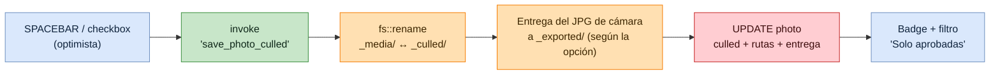
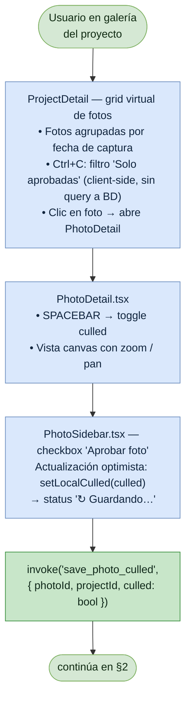
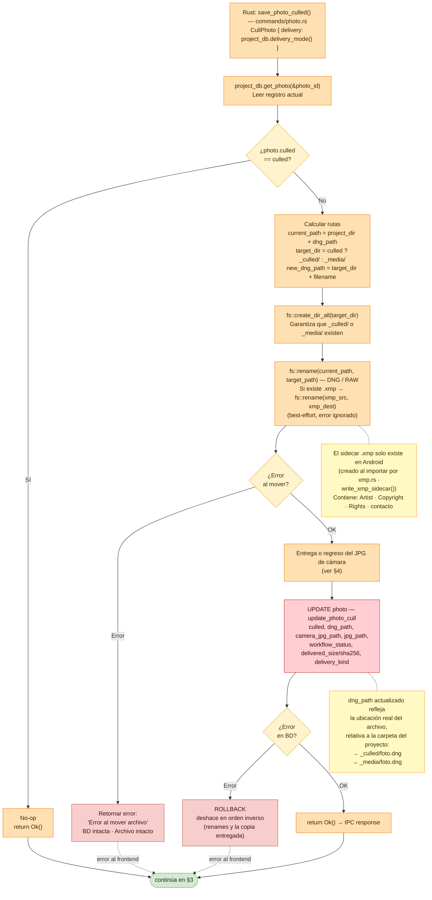
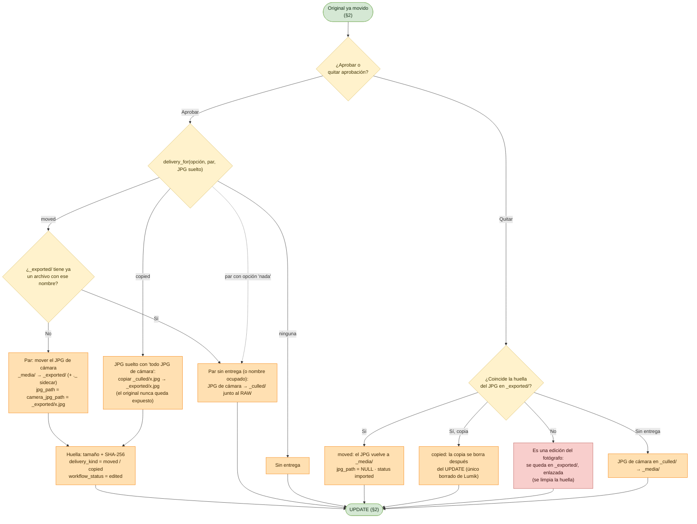

# Flujo: Culling de imagen

Lumik Desktop · Linux · Windows · Android

Marcar una foto como *culled* mueve el archivo entre `_media/` y `_culled/` y actualiza
`dng_path` en la base. El movimiento de archivo ocurre **antes** del `UPDATE`, y si la base
falla se revierten los movimientos en orden inverso.

Según la opción **"Al aprobar, entregar directamente"** del proyecto (`project_settings.delivery_mode`:
`none` / `pairs` / `all_camera_jpg`), aprobar también entrega el JPG de cámara a `_exported/`:
el JPG de un par RAW+JPG se **mueve** y un JPG suelto se **copia**. Lumik guarda la huella
(tamaño + SHA-256) del JPG entregado; quitar la aprobación lo deshace solo si sigue igual.
Ver §4.

> El rating (estrellas, color labels, tags) comparte el sidebar pero es un comando distinto y
> no toca el sistema de archivos: ver [flujo-rating-estrellas.md](flujo-rating-estrellas.md).

## Vista general

## 1. Disparadores en la UI

## 2. Movimiento de archivo y persistencia (backend)

## 3. Respuesta al usuario

## 4. Entrega del JPG de cámara

Cambiar la opción con fotos ya aprobadas pasa por `plan_project_delivery_change` (conteo para el
aviso, por tamaño) y `set_project_delivery_mode { apply_to_approved }` (`ChangeDeliveryMode`,
que reusa `CullPhoto::deliver_approved` / `return_delivery` foto por foto, verificando la huella
completa). Un JPG que se une a una foto ya aprobada en el import se entrega con
`CullPhoto::deliver_joined`.

## Notas

| Punto | Detalle |
|-------|---------|
| Orden de operaciones | Archivo primero, base después. Si el `fs::rename` falla no se toca la base; si la base falla, el archivo se devuelve a su sitio. |
| No-op | Si `photo.culled` ya coincide con el valor pedido, el comando retorna `Ok()` sin mover nada. |
| Sidecar `.xmp` | Se mueve junto al RAW, pero su error se ignora (best-effort). Solo existe en Android. |
| Filtro 'Solo aprobadas' | Es client-side (`Ctrl+C`), no re-consulta la base. |
| Pares RAW+JPG | Una sola foto: `dng_path` es el RAW y `camera_jpg_path` su JPG; los dos se mueven juntos. |
| Nada se borra en la nube | Regresar un JPG ya respaldado no toca su copia en la nube. |
