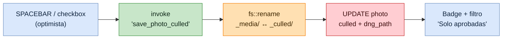
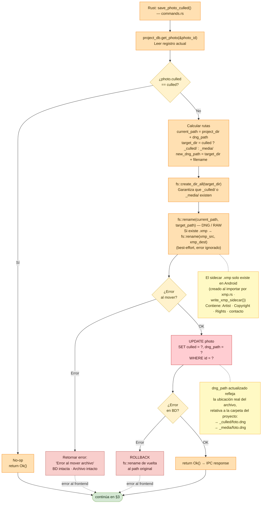
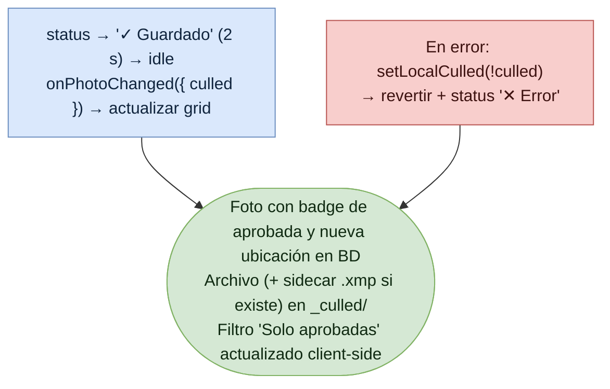

# Flujo: Culling de imagen

Lumik Desktop · Linux · Windows · Android

Marcar una foto como *culled* mueve el archivo entre `_media/` y `_culled/` y actualiza
`dng_path` en la base. El movimiento de archivo ocurre **antes** del `UPDATE`, y si la base
falla se revierte el archivo a su ruta original.

> El rating (estrellas, color labels, tags) comparte el sidebar pero es un comando distinto y
> no toca el sistema de archivos: ver [flujo-rating-estrellas.md](flujo-rating-estrellas.md).

## Vista general

## 1. Disparadores en la UI

## 2. Movimiento de archivo y persistencia (backend)

## 3. Respuesta al usuario

## Notas

| Punto | Detalle |
|-------|---------|
| Orden de operaciones | Archivo primero, base después. Si el `fs::rename` falla no se toca la base; si la base falla, el archivo se devuelve a su sitio. |
| No-op | Si `photo.culled` ya coincide con el valor pedido, el comando retorna `Ok()` sin mover nada. |
| Sidecar `.xmp` | Se mueve junto al RAW, pero su error se ignora (best-effort). Solo existe en Android. |
| Filtro 'Solo aprobadas' | Es client-side (`Ctrl+C`), no re-consulta la base. |
