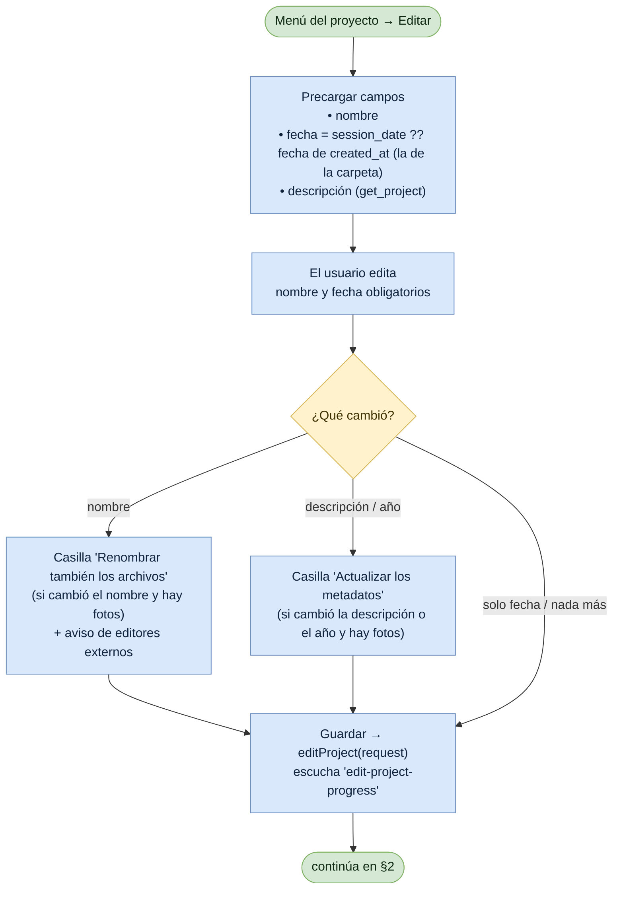
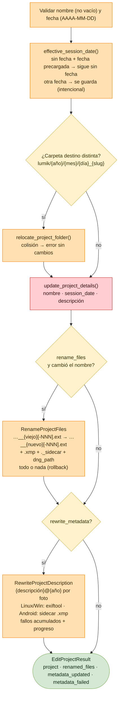

# Flujo: Editar Proyecto

Lumik Desktop · Linux · Windows · Android

Desde el menú de la tarjeta del proyecto (*Editar*) se cambian el nombre, la fecha de sesión y
la descripción. Siempre se actualizan `project.db` y, si cambian el nombre o la fecha, la
carpeta del proyecto. Dos casillas opcionales extienden el cambio a las fotos ya importadas:
renombrar los archivos y reescribir la descripción embebida.

## Vista general

```mermaid
flowchart LR
    A["Formulario<br/>EditProjectModal"]
    B["invoke<br/>'edit_project'"]
    C["Validar +<br/>fecha efectiva"]
    D["Mover carpeta<br/>(si cambia)"]
    E["Actualizar<br/>project.db"]
    F["Renombrar archivos<br/>(opcional)"]
    G["Reescribir descripción<br/>(opcional)"]
    H["Dashboard: refetch +<br/>nube + catálogo"]

    A --> B --> C --> D --> E --> F --> G --> H

    classDef ui fill:#dae8fc,stroke:#6c8ebf,color:#10243d
    classDef ipc fill:#c8e6c9,stroke:#388e3c,color:#10281a
    classDef be fill:#ffe0b2,stroke:#f57c00,color:#3d2600
    classDef db fill:#ffcdd2,stroke:#c62828,color:#3d0d0d
    class A,H ui
    class B ipc
    class C,D,F,G be
    class E db
```

## 1. Formulario (frontend)

## 2. Backend (`edit_project`)

## Archivos fuente

| Paso | Archivo |
|------|---------|
| Formulario (§1) | `src/pages/Project/Projects/EditProjectModal.tsx` · `src/components/DateField.tsx` |
| Dashboard | `src/pages/Project/Projects/Projects.tsx` — `handleEdited()` (refetch, `relocate_backup`, `ensure_project_synced`) |
| Comando (§2) | `src-tauri/src/commands/project.rs` — `edit_project()` |
| Reglas | `src-tauri/src/domain/project.rs` — `effective_session_date()`, `renamed_photo_file()`, `sanitize_file_name()`, `image_description()` |
| Renombrar archivos | `src-tauri/src/application/use_cases/rename_project_files.rs` |
| Reescribir descripción | `src-tauri/src/application/use_cases/rewrite_project_description.rs` · `MetadataTool::set_image_description` |

## Notas

| Punto | Detalle |
|-------|---------|
| Fecha precargada | Si el proyecto no tenía fecha y se guarda con la precargada, sigue sin fecha y la próxima importación puede inferirla. Elegir a propósito la fecha de creación no la fija. |
| Fallo al renombrar | La carpeta y `project.db` ya quedaron con el nombre nuevo; los archivos vuelven a su nombre anterior. Es un estado válido y se puede reintentar marcando la casilla. |
| `_exported/` | No se toca nunca. Los JPEG ya enlazados siguen enlazados (por `jpg_path`); los que se exporten después con el nombre viejo no se enlazarán. |
| Archivos sin renombrado | Los importados con el renombrado desactivado (`IMG_4821.CR3`) conservan su nombre. |
| Fechas y archivos | Cambiar la fecha mueve la carpeta pero no renombra archivos: usan la fecha de captura. |
