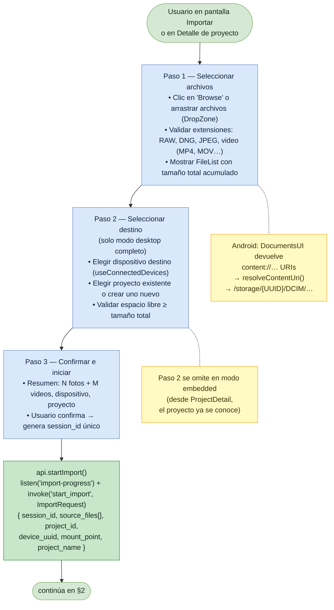
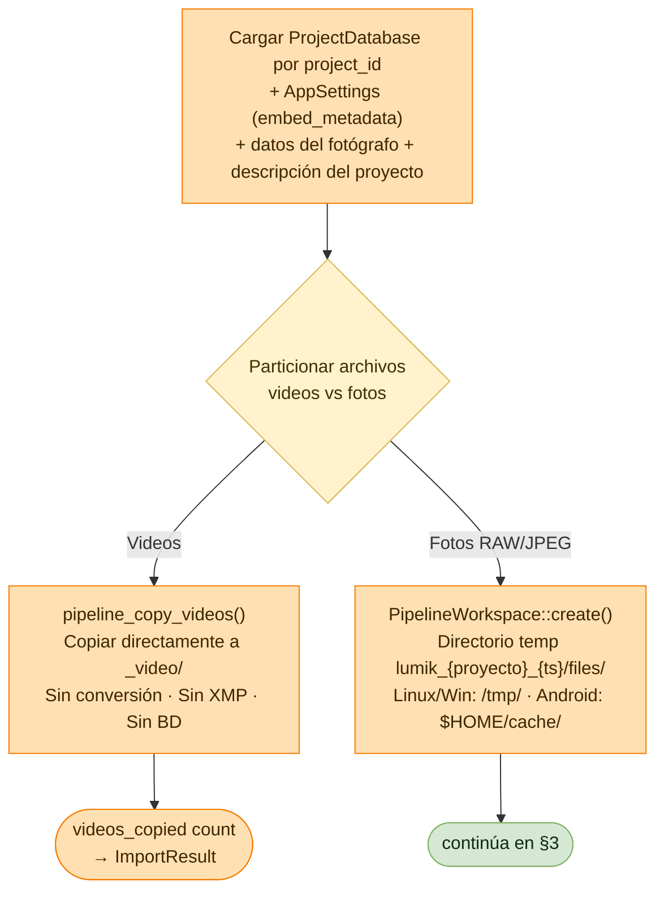
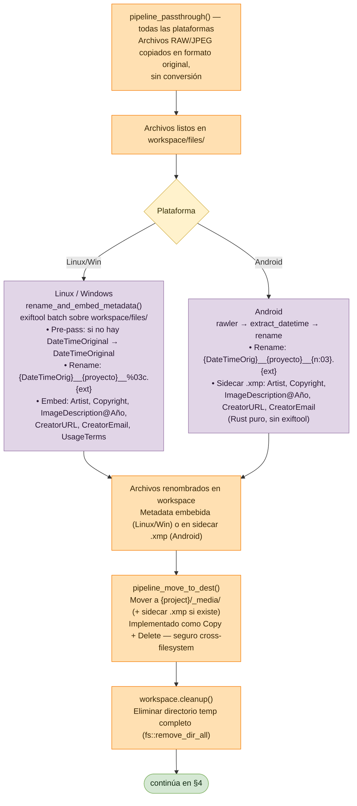
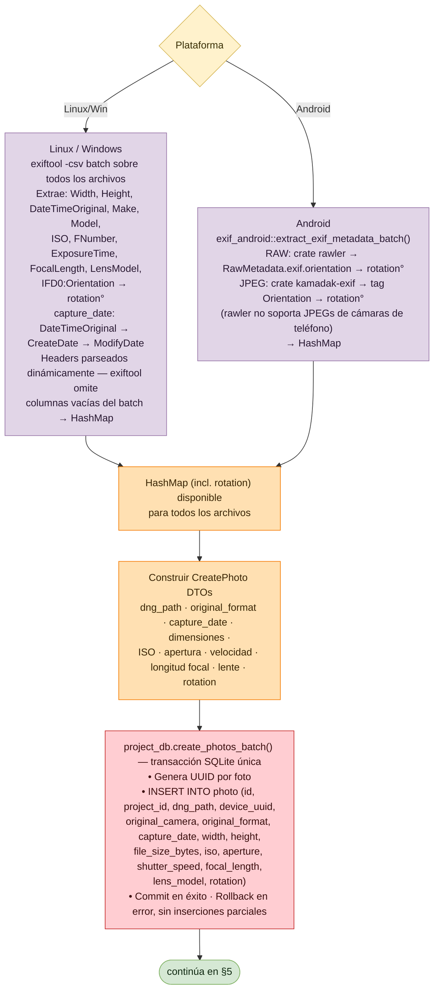
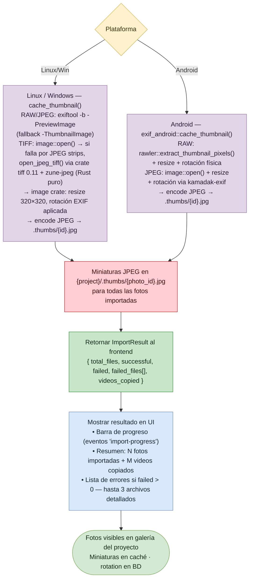
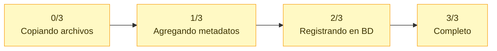

# Flujo: Importar Imágenes a un Proyecto

Lumik Desktop · Linux · Windows · Android

Wizard de 3 pasos en el frontend y un pipeline de 5 fases en Rust: copia a un workspace
temporal, metadatos y renombrado, movimiento a `_media/`, extracción EXIF e inserción en
`project.db`, y generación de miniaturas.

> **Splits por plataforma:** en los diagramas que se bifurcan, la rama izquierda es
> **Linux / Windows** (vía `exiftool`) y la derecha **Android** (Rust puro, sin `exiftool`).

## Vista general

```mermaid
flowchart LR
    W["Wizard<br/>3 pasos"]
    I["invoke<br/>'start_import'"]
    P["Particionar<br/>videos / fotos"]
    C["Workspace temp<br/>+ copia"]
    M["Metadatos<br/>+ renombrado"]
    D["Mover a _media/"]
    X["EXIF → DTOs"]
    B["create_photos_batch()"]
    T["Miniaturas<br/>.thumbs/"]
    R["ImportResult"]

    W --> I --> P --> C --> M --> D --> X --> B --> T --> R

    classDef ui fill:#dae8fc,stroke:#6c8ebf,color:#10243d
    classDef ipc fill:#c8e6c9,stroke:#388e3c,color:#10281a
    classDef be fill:#ffe0b2,stroke:#f57c00,color:#3d2600
    classDef db fill:#ffcdd2,stroke:#c62828,color:#3d0d0d
    class W ui
    class I,R ipc
    class P,C,M,D,X,T be
    class B db
```

## 1. Wizard de importación (frontend)

## 2. Arranque del backend y particionado

Los videos salen del pipeline de inmediato: se copian tal cual, sin conversión, sin XMP y
sin registro en base de datos.

## 3. Copia, metadatos y movimiento a destino

## 4. Extracción EXIF e inserción en base de datos

## 5. Miniaturas y resultado

Las miniaturas se generan en paralelo, con un máximo de 8 hilos.

## 6. Eventos de progreso

El backend emite `app.emit('import-progress', progress)`. La granularidad es **por fase, no
por archivo**; el frontend filtra por `session_id`.

`ImportPhase` admite `Reading`, `Converting`, `Writing`, `Saving`, `Complete` y `Failed`.

## Archivos de código

| Fase | Archivos |
|------|----------|
| Wizard (§1) | `src/pages/ImportPage.tsx` — wizard 3 pasos, DropZone, FileList, `handleBrowse()`, `resolveContentUri()` (Android); auto-muestra importación si el proyecto está vacío |
| IPC (§1) | `src/lib/api.ts` — `startImport()`, `listen('import-progress')` · `src/lib/hooks.ts` — `useImport()`, `session_id` |
| Arranque (§2) | `src-tauri/src/commands.rs` — `start_import()`, `AppSettings(embed_metadata)`, particionado, `image_description = {desc}@{year}` |
| Workspace (§2–3) | `src-tauri/src/import/pipeline.rs` — `PipelineWorkspace::create()` (solo `files/`), `pipeline_passthrough()`; temp dir `/tmp` (Linux/Win) o `$HOME/cache` (Android) |
| Metadatos (§3) | `src-tauri/src/import/pipeline.rs` — `pipeline_metadata()`, split Linux vs Android, `rename_and_embed_metadata()` · `src-tauri/src/import/xmp.rs` — `write_xmp_sidecar()` (Rust puro) |
| Movimiento (§3) | `src-tauri/src/import/pipeline.rs` — `pipeline_move_to_dest()`, `move_dng_files()`, Copy + Delete cross-FS, `.xmp` excluidos de la lista EXIF, `workspace.cleanup()` |
| EXIF (§4) | `src-tauri/src/commands.rs` — `extract_exif_metadata_batch()`, `exiftool -csv`, headers dinámicos, `-IFD0:Orientation` → `rotation°` · `src-tauri/src/exif_android.rs` — RAW con `rawler`, JPEG con `kamadak-exif` |
| Inserción (§4) | `src-tauri/src/commands.rs` — `create_photos_batch()`, `CreatePhoto` incl. `rotation` · `src-tauri/src/db/queries.rs` · `db/project_schema.sql`; migración automática `ALTER TABLE ADD COLUMN rotation` |
| Miniaturas (§5) | `src-tauri/src/commands.rs` — `cache_thumbnail()`, `cache_thumbnails_parallel()` · `src-tauri/src/exif_android.rs` — `rawler::extract_thumbnail_pixels()`, `image::open()` + rotación `kamadak-exif` |
| Progreso (§6) | `src-tauri/src/import/progress.rs` — `ImportPhase`, `ImportProgress`, `ImportResult`, `FailedFile`, `ImportLogEntry` (serializados en eventos Tauri) |
| Resultado (§5) | `src/lib/hooks.ts` — `useImport()` sobre el evento `import-progress` · `src/pages/ImportPage.tsx` — barra de progreso, resumen, lista de errores |
