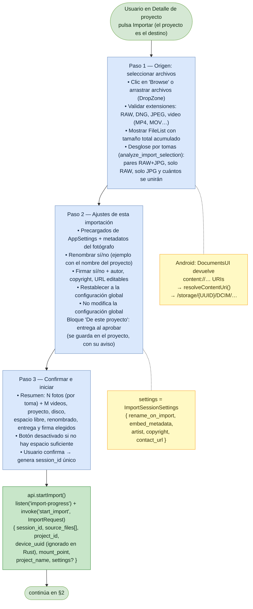
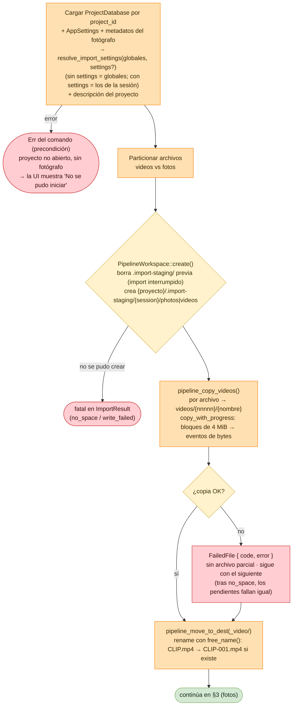
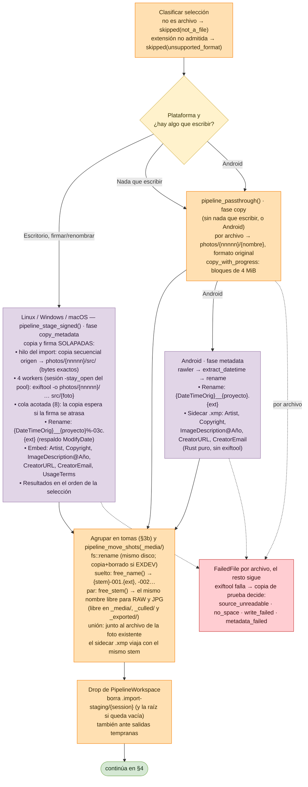
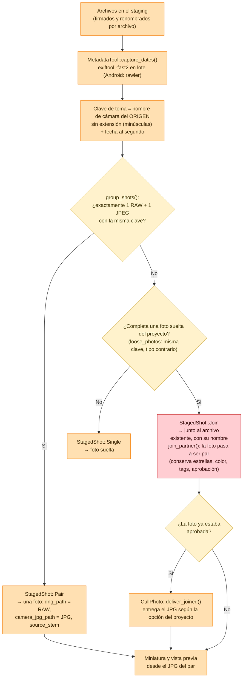
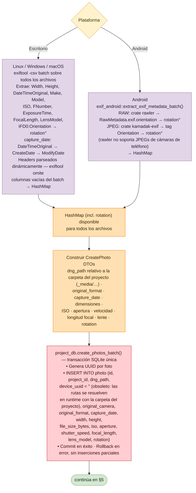
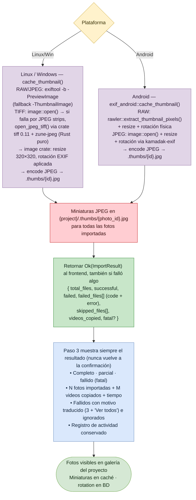
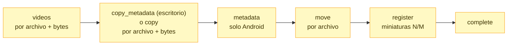
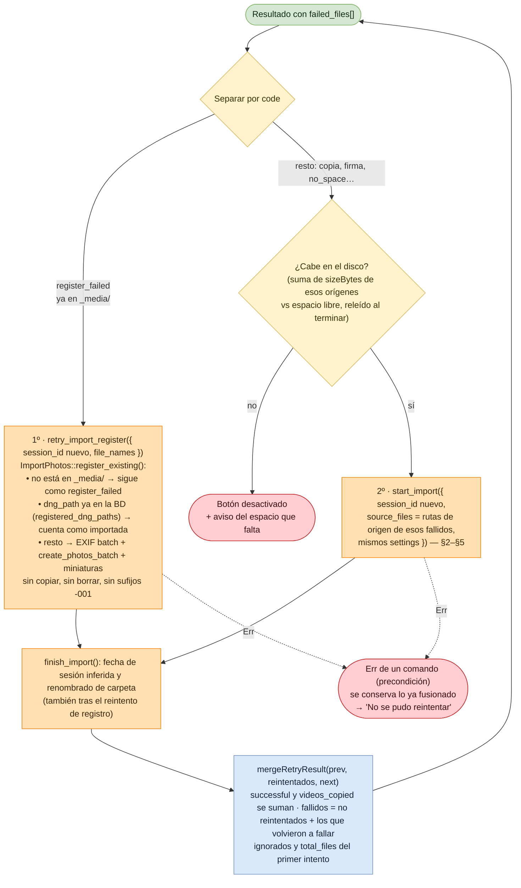

# Flujo: Importar Imágenes a un Proyecto

Lumik Desktop · Linux · Windows · Android

Wizard de 3 pasos en el frontend (origen, ajustes, confirmar; solo desde un proyecto) y un pipeline en Rust que procesa
**archivo por archivo**: copia de videos y fotos a un staging dentro del proyecto
(`.import-staging/`, mismo disco que el destino), metadatos y renombrado, `rename` a `_video/` y `_media/` sin
sobrescribir, extracción EXIF e inserción en `project.db`, y generación de miniaturas. Un archivo que falla se
registra con su motivo y el resto sigue; el resultado se muestra siempre, y desde ahí se pueden reintentar
los fallidos (§7).

Un RAW y un JPG de la misma toma (mismo nombre de cámara sin extensión y misma fecha de captura al
segundo) se registran como **una sola foto, un par**, aunque vengan de carpetas o tarjetas distintas o
en imports separados (§3b). El import cuenta tomas, no archivos.

> **Splits por plataforma:** en los diagramas que se bifurcan, la rama izquierda es
> **Linux / Windows** (vía `exiftool`) y la derecha **Android** (Rust puro, sin `exiftool`).

## Vista general

```mermaid
flowchart LR
    W["Wizard<br/>3 pasos"]
    I["invoke<br/>'start_import'"]
    P["Particionar<br/>videos / fotos"]
    C["Staging en el proyecto<br/>+ copia por archivo"]
    M["Metadatos<br/>+ renombrado"]
    G["Agrupar en tomas<br/>(pares RAW+JPG, uniones)"]
    D["rename a _media/<br/>(nombre libre por toma)"]
    X["EXIF → DTOs"]
    B["create_photos_batch()"]
    T["Miniaturas<br/>.thumbs/"]
    R["ImportResult"]

    W --> I --> P --> C --> M --> G --> D --> X --> B --> T --> R

    classDef ui fill:#dae8fc,stroke:#6c8ebf,color:#10243d
    classDef ipc fill:#c8e6c9,stroke:#388e3c,color:#10281a
    classDef be fill:#ffe0b2,stroke:#f57c00,color:#3d2600
    classDef db fill:#ffcdd2,stroke:#c62828,color:#3d0d0d
    class W ui
    class I,R ipc
    class P,C,M,G,D,X,T be
    class B db
```

## 1. Wizard de importación (frontend)

## 2. Arranque del backend, staging y videos

Fotos y videos comparten el staging de la sesión. Los videos se copian primero, sin
conversión, sin XMP y sin registro en base de datos.

## 3. Fotos: copia, metadatos y movimiento a destino

## 3b. Pares RAW+JPG y uniones

El reintento de fallidos por copia vuelve a `start_import`, así que un JPG que falló se une a su RAW
por la misma regla. `register_existing` (fallidos al registrar, ya en `_media/`) empareja por el
nombre final y no une con fotos existentes.

## 4. Extracción EXIF e inserción en base de datos

## 5. Miniaturas y resultado

Las miniaturas se generan en paralelo, con un máximo de 8 hilos; cada una emite progreso
(fase `register`, N de M) y una entrada `thumbnail` en el registro. Si falla la inserción en
la BD, todas las fotos del lote se informan como fallidas (`register_failed`).

## 6. Eventos de progreso

El backend emite dos eventos, filtrados por `session_id` en `useImport()`:

- `import-progress` — `ImportProgress { phase, file_name, file_index, file_total, file_bytes,
  file_bytes_total, bytes_done, bytes_total }`. Granularidad **por archivo**; los bytes avanzan
  en `videos`, `copy` y `copy_metadata` (siempre por la copia secuencial; como máximo un evento cada ~100 ms por archivo, más uno al empezar y
  al terminar cada archivo). La barra de la UI sigue `bytes_done / bytes_total`.
- `import-log` — `ImportLogEntry { kind, file_name?, code?, count?, detail? }`, traducido en el
  frontend con `import.log.<kind>` e `import.errors.codes.<code>`.

Códigos de error (`ImportErrorCode`): `source_unreadable`, `no_space`, `write_failed`,
`metadata_failed`, `register_failed`, `unknown`.

## 7. Reintentar fallidos

Desde el resultado, "Reintentar (N)" procesa solo los fallidos, en el mismo proyecto y con los mismos
ajustes de la sesión. El resultado y el registro se acumulan: tras cada reintento muestran el total de la
sesión, y si algo vuelve a fallar el botón sigue disponible.

## Archivos de código

| Fase | Archivos |
|------|----------|
| Wizard (§1) | `src/pages/ImportPage.tsx` — wizard 3 pasos (origen, ajustes de la importación, confirmar), DropZone, FileList, `handleBrowse()`, `resolveContentUri()` (Android); auto-muestra importación si el proyecto está vacío |
| IPC (§1, §7) | `src/lib/api.ts` — `startImport()`, `retryImportRegister()`, `listen('import-progress')` · `src/lib/hooks.ts` — `useImport()`, `session_id` |
| Arranque (§2) | `src-tauri/src/commands/import_cmd.rs` — `start_import()`, particionado, `image_description = {desc}@{year}` · `src-tauri/src/application/import_settings.rs` — `resolve_import_settings()` (ajustes de la sesión contra los globales) |
| Staging (§2–3) | `src-tauri/src/import/pipeline.rs` — `PipelineWorkspace::create(project_dir, session_id)` en `{proyecto}/.import-staging/`, `Drop` que limpia, `copy_with_progress()`, `pipeline_copy_videos()`, `pipeline_passthrough()` · `src-tauri/src/infrastructure/import_pipeline.rs` — `StdImportPipeline::import()`, eventos y `EmitThrottle` |
| Metadatos (§3) | `src-tauri/src/import/pipeline.rs` — escritorio: `exiftool_metadata_args()`, `pipeline_stage_signed()`, `sign_one()` · Android: `pipeline_metadata()` · `src-tauri/src/exiftool.rs` — pool `run_text_in()` / `close_pool()` · `src-tauri/src/import/xmp.rs` — `write_xmp_sidecar()` (Rust puro) |
| Movimiento (§3) | `src-tauri/src/import/pipeline.rs` — `pipeline_move_shots()`, `move_pair()`, `move_into()`, `free_name()` y `free_stem()` (sufijo `-001`…), `fs::rename` con respaldo copia+borrado, `.xmp` excluidos de la lista EXIF |
| Pares (§3b) | `src-tauri/src/domain/pairs.rs` — `ShotKey`, `FileKind`, `group_shots()` · `src-tauri/src/infrastructure/import_pipeline.rs` — `stage_shots()` · `src-tauri/src/application/use_cases/import_photos.rs` — `existing_shots()`, `join()`, `import_breakdown()` · `src-tauri/src/commands/import_cmd.rs` — `analyze_import_selection()` |
| EXIF (§4) | `src-tauri/src/commands.rs` — `extract_exif_metadata_batch()`, `exiftool -csv`, headers dinámicos, `-IFD0:Orientation` → `rotation°` · `src-tauri/src/exif_android.rs` — RAW con `rawler`, JPEG con `kamadak-exif` |
| Inserción (§4) | `src-tauri/src/commands.rs` — `create_photos_batch()`, `CreatePhoto` incl. `rotation` · `src-tauri/src/db/queries.rs` · `db/project_schema.sql`; migración automática `ALTER TABLE ADD COLUMN rotation` |
| Miniaturas (§5) | `src-tauri/src/commands.rs` — `cache_thumbnail()`, `cache_thumbnails_parallel()` · `src-tauri/src/exif_android.rs` — `rawler::extract_thumbnail_pixels()`, `image::open()` + rotación `kamadak-exif` |
| Progreso (§6) | `src-tauri/src/import/progress.rs` — `ImportPhase`, `ImportProgress`, `ImportErrorCode`, `error_code_for()`, `FailedFile`, `SkippedFile`, `FatalError`, `ImportLogEntry`, `ImportResult` (serializados en eventos Tauri) |
| Caso de uso (§2–5) | `src-tauri/src/application/use_cases/import_photos.rs` — `ImportPhotos::execute()` (siempre devuelve `ImportOutcome`), registro y miniaturas solo de las fotos movidas |
| Resultado (§5) | `src/lib/hooks.ts` — `useImport()` con estado `idle / importing / done` · `src/pages/ImportPage.tsx` — progreso por bytes y archivo, resultado completo/parcial/fallido, fallidos e ignorados, registro traducido |
| Reintento (§7) | `src/pages/ImportPage.tsx` — `retryPlan` (registro vs copia, espacio), `handleRetry()` · `src/lib/hooks.ts` — `useImport().retry()`, `mergeRetryResult()` · `src-tauri/src/commands/import_cmd.rs` — `retry_import_register()`, `finish_import()` (compartido con `start_import`) · `src-tauri/src/application/use_cases/import_photos.rs` — `ImportPhotos::register_existing()` · `src-tauri/src/db/queries.rs` — `get_registered_dng_paths()` |
