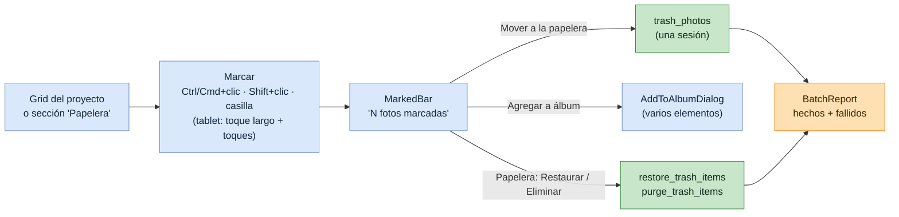
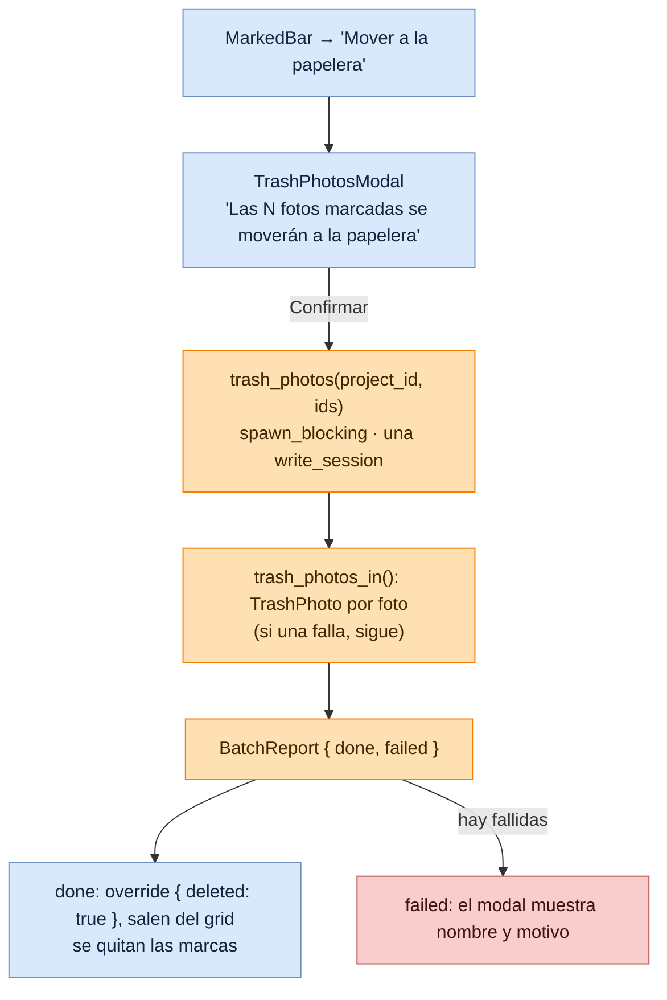
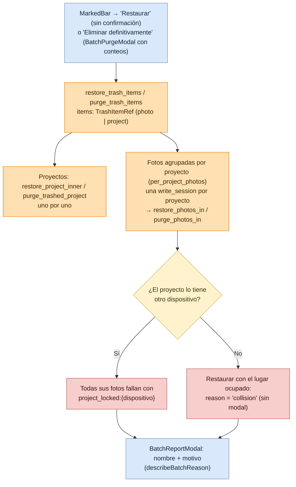

# Flujo: Marcar fotos y actuar en lote

Lumik Desktop · Linux · Windows · macOS · Android (tablet)

"Marcar" junta varias fotos del grid de un proyecto, o varios elementos de la sección "Papelera",
para actuar sobre todos a la vez. **No es aprobar**: en Lumik "seleccionar/aprobar" mueve el
archivo a `_culled/`, y marcar no cambia nada de la foto. Las marcas son estado de la vista, por
id: no se guardan y se quitan al cambiar filtros, orden, vista, proyecto o sección, al terminar
una acción y con Esc.

Cada lote encadena el caso de uso de un elemento (`TrashPhoto`, `RestorePhoto`, `PurgePhoto`,
restaurar o eliminar un proyecto), cada uno con su rollback. Si uno falla, el lote sigue y al
final informa cuáles fallaron y por qué.

## Vista general



## 1. Marcar (desktop)

```mermaid
flowchart TD
    click(["Clic en una tarjeta"])
    intent{"clickIntent()<br/>lib/marking.ts"}
    range["Shift: markRange()<br/>del ancla a la foto, en el orden del grid<br/>(sin ancla visible: solo esa foto)"]
    toggle["Ctrl/Cmd (hasPlatformModifier)<br/>o ya hay marcas: toggleMark()"]
    open["Sin marcas ni teclas:<br/>abre el visor como siempre"]
    box["Casilla de la tarjeta (MarkToggle)<br/>marca sin abrir el visor"]
    esc{"Esc (project.back)"}
    clear["Con marcas: las quita"]
    back["Sin marcas: regresa"]

    click --> intent
    intent -->|range| range
    intent -->|toggle| toggle
    intent -->|open| open
    box --> toggle
    esc -->|hay marcas| clear
    esc -->|no hay| back

    classDef ui fill:#dae8fc,stroke:#6c8ebf,color:#10243d
    classDef dec fill:#fff2cc,stroke:#d6b656,color:#3d3100
    classDef term fill:#d5e8d4,stroke:#82b366,color:#102a12
    class click term
    class range,toggle,open,box,clear,back ui
    class intent,esc dec
```

En la tablet, el toque largo entra al modo marcar con esa foto (el menú de la tarjeta queda en su
botón ⋮), cada toque marca o desmarca, y "Listo" sale. En solo lectura no hay modo marcar. La
tablet no tiene álbumes: su barra solo ofrece "Mover a la papelera".

## 2. Mandar varias a la papelera



En la tablet, `session.trashPhotos()` hace lo mismo sobre la copia de trabajo, con una sola recarga
y una sola devolución de `project.db` al disco.

## 3. Restaurar y eliminar en lote (sección "Papelera")



Lo que choca al restaurar se queda en la papelera y se restaura después uno por uno, con el modal
de colisión que pide otro nombre. En la tablet, `restoreTrashedPhotos` / `purgeTrashedPhotos` hacen
una sola ida y vuelta de `project.db` por proyecto.

## Notas

| Punto | Detalle |
|-------|---------|
| Vocabulario | "Marcar" / "fotos marcadas"; nunca "seleccionar", que es aprobar. |
| Rangos | Shift+clic sigue el orden en que se ve el grid (agrupado por día o no). En la papelera, los rangos no cruzan discos. |
| Solo lectura | La barra del proyecto no ofrece "Mover a la papelera"; "Agregar a álbum" sí. |
| Álbum | `AddToAlbumDialog` recibe todos los elementos y ya dice cuántos se agregaron y cuántos ya estaban; `onAdded` quita las marcas. |
| Motivos | `collision` → "su lugar está ocupado"; `project_locked:X` → "el proyecto está en uso en X"; el resto, el mensaje del error. |

## Código

| Pieza | Archivo |
|-------|---------|
| Reglas de marcas | `apps/desktop/src/lib/marking.ts` (`toggleMark`, `markRange`, `clickIntent`) |
| Tarjetas y barra | `packages/ui/src/components/MarkToggle/`, `MarkedBar/`, `PhotoCard` y `ProjectCard` (`marked`, `onToggleMark`) |
| Grid del proyecto | `apps/desktop/src/pages/Project/ProjectDetail/ProjectDetail.tsx`, `TrashPhotosModal.tsx` |
| Papelera | `apps/desktop/src/pages/Trash/TrashPage.tsx`, `TrashModals.tsx` (`BatchPurgeModal`, `BatchReportModal`) |
| Comandos | `apps/desktop/src-tauri/src/commands/trash_batch.rs` (`trash_photos`, `restore_trash_items`, `purge_trash_items`) |
| Tablet | `apps/tablet/src/ProjectScreen.tsx`, `TrashScreen.tsx`, `session.ts` (`trashPhotos`), `projectActions.ts` (`restoreTrashedPhotos`, `purgeTrashedPhotos`) |
