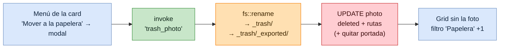
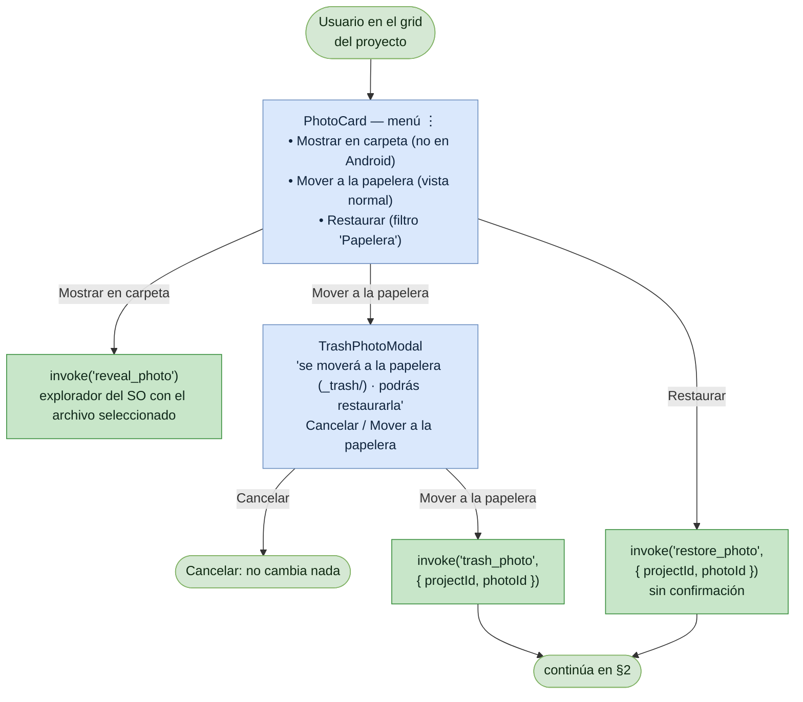
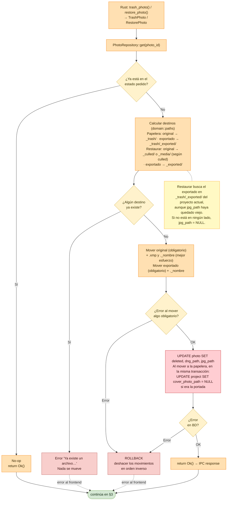
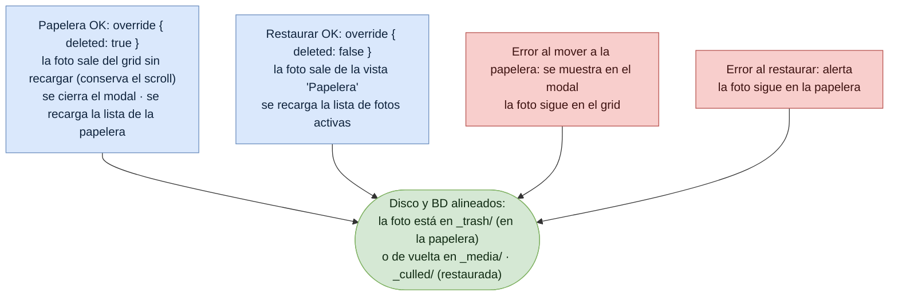

# Flujo: Papelera y restaurar foto

Lumik Desktop · Linux · Windows · Android

Mover una foto a la papelera es un **borrado lógico**: la fila queda con `deleted = 1` y sus
archivos se apartan dentro del proyecto, sin borrar nada. El original va a `_trash/` y su JPG
exportado a `_trash/_exported/` (así un original JPG y su exportado con el mismo nombre no se
pisan, y los escaneos de `_exported/` no lo vuelven a enlazar ni a respaldar). Restaurar hace lo
inverso.

Igual que en el [culling](flujo-culling.md), los archivos se mueven **antes** del `UPDATE`, y si
algo falla se devuelven a su sitio.

> La papelera no se propaga todavía al catálogo del servidor: el portal web y el iPad siguen
> mostrando la foto. Las copias ya respaldadas se conservan.

## Vista general

## 1. Disparadores en la UI

## 2. Movimiento de archivos y persistencia (backend)

## 3. Respuesta al usuario

## Notas

| Punto | Detalle |
|-------|---------|
| Nunca se borra | La papelera solo mueve archivos dentro del proyecto. Vaciar `_trash/` es manual. |
| Por qué "papelera" | En proyectos, "Eliminar" es permanente y "Archivar" oculta sin cambiar nada; esta acción es reversible pero saca la foto del respaldo. La columna de BD sigue siendo `deleted`. |
| Sin sobrescribir | Antes de mover se comprueba que ningún destino exista. Si existe, la operación falla sin cambios. |
| Efectos de `deleted = 1` | `get_project_photos` la excluye, así que desaparece del grid, del conteo del dashboard y del respaldo. |
| Aprobación bloqueada | `CullPhoto` rechaza una foto en la papelera; en el visor no hay actualización optimista. |
| Filtro 'Papelera' | Cambia la fuente del grid a `get_project_trashed_photos`. No se guarda en `project_settings`. |
| Mostrar en carpeta | `reveal_item_in_dir` de `tauri-plugin-opener`. En Linux depende de `org.freedesktop.FileManager1`. |

## Código

| Pieza | Archivo |
|-------|---------|
| Menú de la card | `packages/ui/src/components/CardMenu/CardMenu.tsx`, `PhotoCard/PhotoCard.tsx` |
| UI del flujo | `apps/desktop/src/pages/Project/ProjectDetail/ProjectDetail.tsx`, `TrashPhotoModal.tsx`, `ProjectDetailFooter.tsx` |
| Comandos | `apps/desktop/src-tauri/src/commands/photo.rs` (`trash_photo`, `restore_photo`, `get_project_trashed_photos`, `reveal_photo`) |
| Casos de uso | `apps/desktop/src-tauri/src/application/use_cases/trash_photo.rs` |
| Reglas de rutas | `apps/desktop/src-tauri/src/domain/paths.rs` |
| Persistencia | `apps/desktop/src-tauri/src/db/queries.rs` (`set_photo_deleted`, `get_project_trashed_photos`) |
