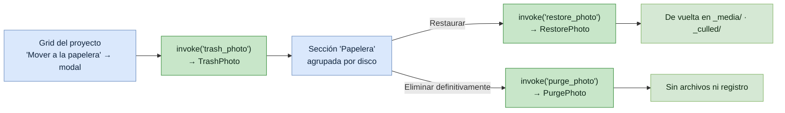
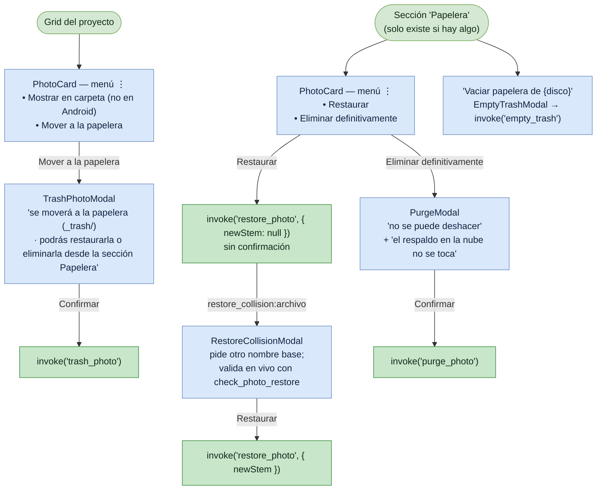
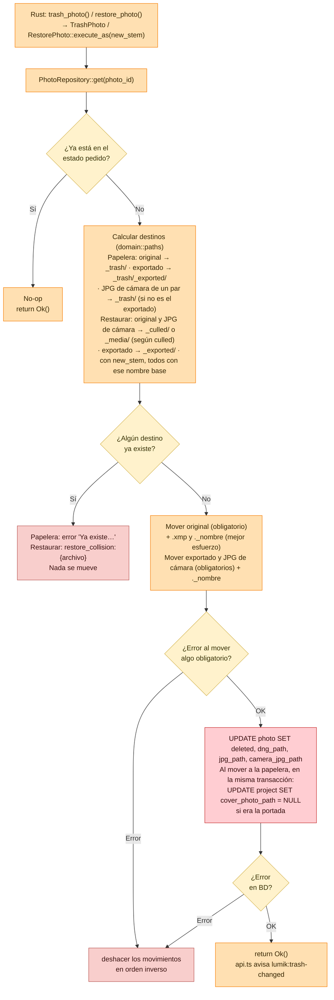
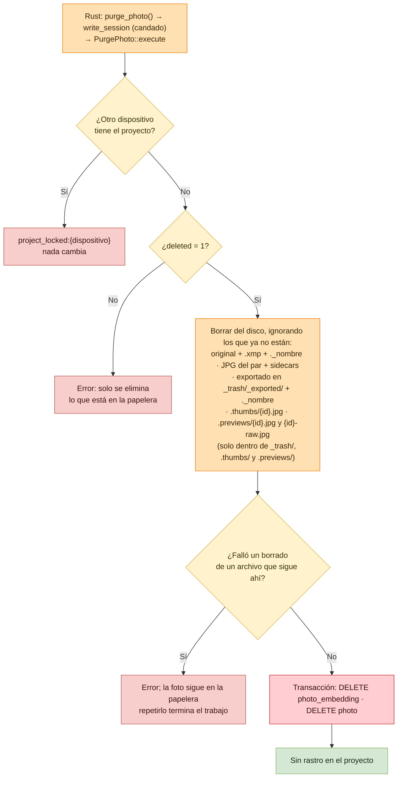

# Flujo: Papelera de fotos (mover, restaurar, eliminar definitivamente)

Lumik Desktop · Linux · Windows · macOS · Android (tablet)

Borrar una foto tiene **dos pasos**. Primero se manda a la papelera: es un borrado lógico, la fila
queda con `deleted = 1` y sus archivos se apartan dentro del proyecto sin borrar nada. El original
va a `_trash/` y su JPG exportado a `_trash/_exported/` (así un original JPG y su exportado con el
mismo nombre no se pisan, y los escaneos de `_exported/` no lo vuelven a enlazar ni a respaldar).
Después, desde la sección **"Papelera"** de la app, se restaura o se **elimina definitivamente**.
Lumik nunca vacía la papelera por su cuenta.

Igual que en el [culling](flujo-culling.md), los archivos se mueven **antes** del `UPDATE`, y si
algo falla se devuelven a su sitio.

Un par RAW+JPG va a la papelera, vuelve y se elimina **con sus dos archivos**: el JPG de cámara se
aparta en `_trash/` junto al RAW (o, si ya se entregó, viaja como exportado a `_trash/_exported/`).

Los proyectos completos siguen su propio flujo: [Papelera de proyectos](flujo-papelera-proyecto.md).
La sección "Papelera" muestra los dos.

> La papelera no se propaga al catálogo del servidor: el portal web y el iPad siguen mostrando la
> foto, y eliminarla definitivamente no toca su respaldo en la nube (se borra desde el portal).

Varias fotos a la vez (mandar a la papelera, restaurar o eliminar en lote): ver
[Marcar fotos y actuar en lote](flujo-marcar-fotos.md).

## Vista general

## 1. Disparadores en la UI

## 2. Mover a la papelera y restaurar (backend)

## 3. Eliminar definitivamente (backend)

## Notas

| Punto | Detalle |
|-------|---------|
| Dos pasos | Mandar a la papelera nunca borra. Solo "Eliminar definitivamente" o "Vaciar papelera", desde la sección, borran archivos. |
| Archivos primero | `PurgePhoto` borra los archivos antes que la fila: si se interrumpe, la foto sigue listada y repetir termina. Al revés quedarían archivos huérfanos invisibles. |
| Sin sobrescribir | Antes de mover se comprueba que ningún destino exista (incluido el `.xmp`). Al restaurar, la colisión abre el modal que pide otro nombre. |
| Efectos de `deleted = 1` | `get_project_photos` la excluye: desaparece del grid, del conteo del dashboard y del respaldo. El grid del proyecto nunca muestra fotos en la papelera. |
| Aprobación bloqueada | `CullPhoto` rechaza una foto en la papelera. |
| Entrada del menú | `TrashContext` recalcula `list_trash` al cambiar los discos y con el evento `lumik:trash-changed` que emite `api.ts` tras cada acción. |
| Respaldo | Eliminar definitivamente no toca la nube: el aviso del modal lo dice. |

## Código

| Pieza | Archivo |
|-------|---------|
| Menú de la card | `packages/ui/src/components/CardMenu/CardMenu.tsx`, `PhotoCard/PhotoCard.tsx` (`onTrash`, `onRestore`, `onPurge`) |
| Mandar a la papelera | `apps/desktop/src/pages/Project/ProjectDetail/ProjectDetail.tsx`, `TrashPhotoModal.tsx` |
| Sección "Papelera" | `apps/desktop/src/pages/Trash/TrashPage.tsx`, `TrashModals.tsx`, `apps/desktop/src/lib/TrashContext.tsx` |
| Comandos | `apps/desktop/src-tauri/src/commands/photo.rs` (`trash_photo`, `restore_photo`, `check_photo_restore`, `reveal_photo`), `commands/trash.rs` (`list_trash`, `purge_photo`, `empty_trash`) |
| Casos de uso | `crates/lumik-core/src/application/use_cases/trash_photo.rs` (`TrashPhoto`, `RestorePhoto`, `PurgePhoto`) |
| Reglas de rutas | `crates/lumik-core/src/domain/paths.rs` |
| Persistencia | `crates/lumik-core/src/db/queries.rs` (`set_photo_deleted`, `purge_trashed_photo`, `get_project_trashed_photos`) |
