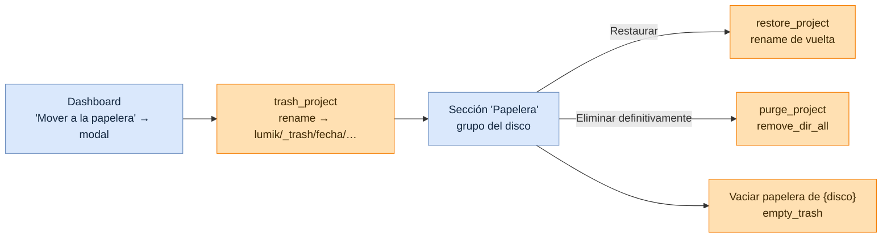
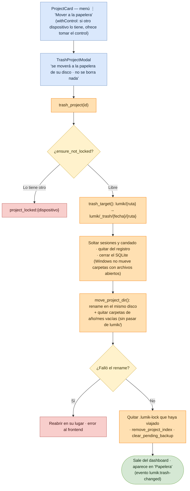
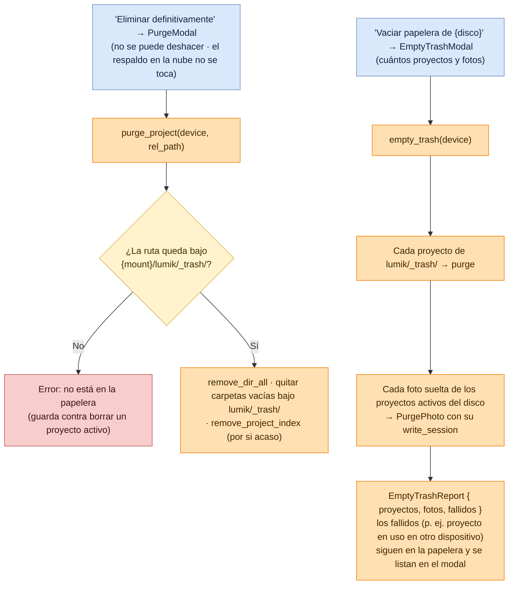

# Flujo: Papelera de proyectos (mandar, restaurar, eliminar, vaciar)

Lumik Desktop · Linux · Windows · macOS · Android (tablet)

Un proyecto ya no se borra en un paso. "Mover a la papelera" mueve su carpeta completa, en el
mismo disco, a `lumik/_trash/{AAAA-MM-DD_HH-MM-SS}/{ruta}` (fecha y hora locales en que se mandó;
guiones porque exFAT no acepta `:`). La carpeta conserva su nombre: mandarla y restaurarla es un
solo movimiento, lo que en la tablet ahorra la mitad del tiempo (cada operación de SAF sobre una
carpeta tarda según cuántos archivos tiene). Lo que haya del formato anterior,
`lumik/_trash/{ruta}__{fecha}`, se sigue listando con su fecha y restaurando. **La ubicación es el estado**: un proyecto está en la papelera
si y solo si su carpeta está bajo `lumik/_trash/`. No hay bandera en ninguna base, ni en la del
proyecto ni en la global. `project.deleted` no se usa.

Como el escaneo de `lumik/` se salta las carpetas que empiezan con `_`, el proyecto sale del
dashboard sin tocar ningún lector: dashboard, búsqueda, respaldo, álbumes y versiones viejas de la
app lo ignoran. La sección **"Papelera"** lo lista recorriendo `lumik/_trash/` de cada disco conectado.

Las fotos del proyecto, incluidas las de su propia papelera, viajan con la carpeta y no se listan
aparte. Las fotos sueltas siguen el [flujo de papelera de fotos](flujo-papelera-foto.md).

Varios elementos a la vez (restaurar o eliminar en lote): ver
[Marcar fotos y actuar en lote](flujo-marcar-fotos.md).

## Vista general



## 1. Mandar a la papelera



## 2. Restaurar (con colisión)

```mermaid
flowchart TD
    click["Sección 'Papelera' → 'Restaurar'<br/>(sin confirmación)"]
    cmd["restore_project(device, rel_path, new_name = null)"]
    target["restore_target(): quitar _trash/{fecha}/<br/>(formato anterior: _trash/ y el sufijo __fecha;<br/>sin fecha reconocible, solo _trash/)"]
    occ_q{"¿Existe ya<br/>esa carpeta?"}
    coll["restore_collision:{carpeta}<br/>nada se mueve"]
    modal["RestoreCollisionModal<br/>campo 'Nombre del proyecto' (inicial: '{nombre} 2')<br/>check_restore_target en vivo: no deja confirmar<br/>vacío ni ocupado"]
    cmd2["restore_project(…, new_name)<br/>destino: misma carpeta padre, {día}_{nombre}"]
    mv["move_project_dir() · quitar carpetas vacías bajo lumik/_trash/<br/>· quitar .lumik-lock viejo · abrir y registrar"]
    named_q{"¿new_name?"}
    rename["write_session · update_project_details(nombre)<br/>· RenameProjectFiles (como al editar el nombre)"]
    index["index_queue.request(id): vuelve a la búsqueda"]
    ok(["Vuelve al dashboard · sale de 'Papelera'"])

    click --> cmd --> target --> occ_q
    occ_q -->|Sí| coll --> modal -->|Restaurar| cmd2 --> mv
    occ_q -->|No| mv
    mv --> named_q
    named_q -->|Sí| rename --> ok
    named_q -->|No| index --> ok

    classDef ui fill:#dae8fc,stroke:#6c8ebf,color:#10243d
    classDef be fill:#ffe0b2,stroke:#f57c00,color:#3d2600
    classDef dec fill:#fff2cc,stroke:#d6b656,color:#3d3100
    classDef err fill:#f8cecc,stroke:#b85450,color:#3d1210
    classDef term fill:#d5e8d4,stroke:#82b366,color:#102a12
    class click,modal ui
    class cmd,cmd2,target,mv,rename,index be
    class occ_q,named_q dec
    class coll err
    class ok term
```

## 3. Eliminar definitivamente y vaciar



## Notas

| Punto | Detalle |
|-------|---------|
| Solo disco local | Nada de la papelera se guarda en `lumik.db`. Lo que hay en un disco desconectado no se ve, y "Vaciar" solo afecta al disco del grupo. |
| Entrada del menú | Solo existe si hay algo en la papelera de los discos conectados, justo antes de Configuración. Si se vacía estando en ella, la app vuelve a Proyectos. |
| Nunca se vacía sola | No hay borrado por antigüedad. |
| Candado | Los proyectos en `_trash/` no se abren para trabajar: su candado no se respeta al eliminarlos y se quita al restaurarlos. |
| Respaldo | Ni mandar a la papelera ni eliminar tocan la nube; el respaldo se borra desde el portal web. Mandar a la papelera sí quita el proyecto de la cola de respaldos pendientes. |
| Tablet | Hace los mismos movimientos por SAF con las reglas de `domain::paths`: un solo `Saf.move` (más `Saf.rename` solo al restaurar con otro nombre o del formato anterior). |
| Avance (tablet) | `MoveSheet`: al mandar, confirma con dos íconos (carpeta → papelera); mientras se mueve, una carpeta salta de uno al otro y se ven los segundos; al terminar, una marca de hecho. Restaurar abre la misma hoja ya moviendo, en sentido inverso (también con otro nombre y en lote con proyectos). Un candado o una colisión la cierran y abren su diálogo. |

## Código

| Pieza | Archivo |
|-------|---------|
| Reglas de rutas | `crates/lumik-core/src/domain/paths.rs` (`project_trash_destination`, `project_restore_destination`, `parse_trashed_at`, `is_inside_project_trash`) |
| Movimientos y listado | `crates/lumik-core/src/application/project_trash.rs` |
| Comandos | `apps/desktop/src-tauri/src/commands/trash.rs` |
| Dashboard | `apps/desktop/src/pages/Project/Projects/Projects.tsx`, `TrashProjectModal.tsx` |
| Sección "Papelera" | `apps/desktop/src/pages/Trash/TrashPage.tsx`, `TrashModals.tsx`, `apps/desktop/src/lib/TrashContext.tsx`, `components/Sidebar.tsx` |
| Tablet | `apps/tablet/src/projectActions.ts` (`trashProject`, `restoreProject`, `moveFolder`), `MoveSheet.tsx`, `ProjectsDashboard.tsx`, `TrashScreen.tsx`, `trash.ts` |
