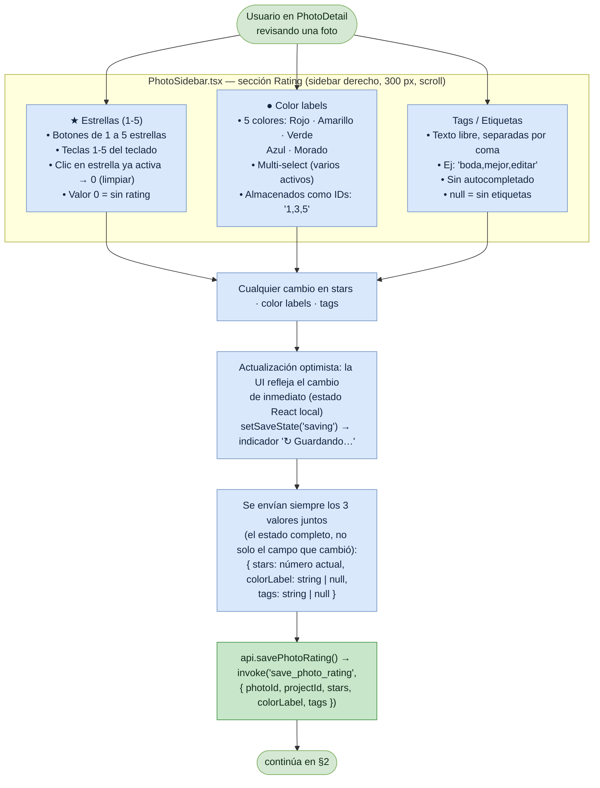
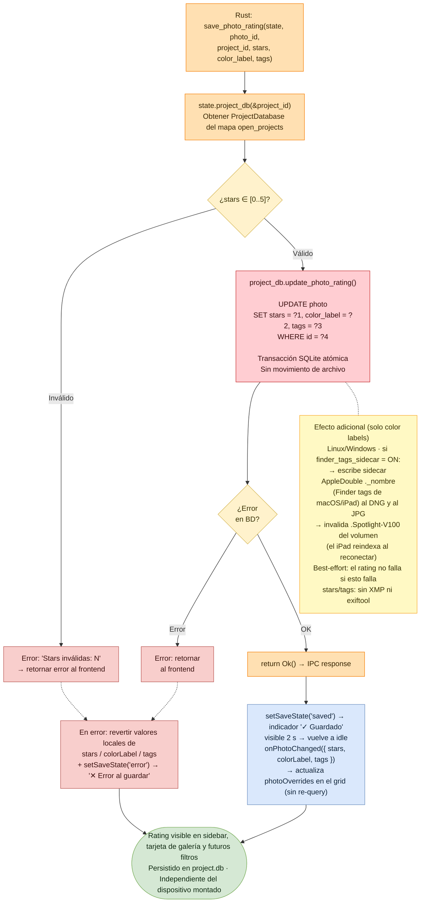

# Flujo: Rating de estrellas, color labels y tags

Lumik Desktop · Linux · Windows · Android

Los tres controles del sidebar (estrellas, color labels, tags) comparten un único comando.
Cada cambio envía **el estado completo de los tres valores**, no solo el campo que cambió.

## 1. Sidebar de rating → IPC (frontend)

## 2. Backend, persistencia y respuesta

## Notas

| Punto | Detalle |
|-------|---------|
| Formato en BD | `color_label` son IDs separados por coma (`"1,3,5"`); `tags` es texto libre separado por coma (`"boda,mejor"`); `null` cuando no hay valor. |
| Sin movimiento de archivo | A diferencia del [culling](flujo-culling.md), el rating nunca toca el sistema de archivos del proyecto. |
| Finder tags para iPad | Solo para color labels, solo en Linux/Windows y solo con `finder_tags_sidecar` activo. Hay que invalidar `.Spotlight-V100` para que el iPad reindexe y pueda filtrar. |
| Independiente del dispositivo | El rating vive en `project.db`, junto a las fotos, así que viaja con el disco externo. |

## Archivos de código

| Fase | Archivos |
|------|----------|
| Sidebar (§1) | `src/pages/Project/PhotoDetail/PhotoSidebar.tsx` — sección rating: estrellas, colores, tags (~líneas 290–350) |
| Atajos (§1) | `src/lib/hooks.ts` — `DEFAULT_KEYBINDINGS`: `photo_detail.stars_0` … `stars_5` |
| Optimismo (§1) | `src/pages/Project/PhotoDetail/PhotoDetail.tsx` — `handleRatingChange()`, `setSaveState()` (~líneas 186–214) |
| IPC (§1) | `src/lib/api.ts` — `savePhotoRating(photoId, projectId, stars, colorLabel, tags)` (~líneas 94–102) |
| Comando (§2) | `src-tauri/src/commands.rs` — `save_photo_rating()` → `sync_color_sidecar()` · `src-tauri/src/apple_tags.rs` — sidecar AppleDouble |
| Estado (§2) | `src-tauri/src/db/mod.rs` — `ProjectDatabase`, mapa `open_projects` (~líneas 185–238) |
| Query (§2) | `src-tauri/src/db/queries.rs` — `update_photo_rating()`, `UPDATE photo SET stars, color_label, tags` (~líneas 533–540) |
