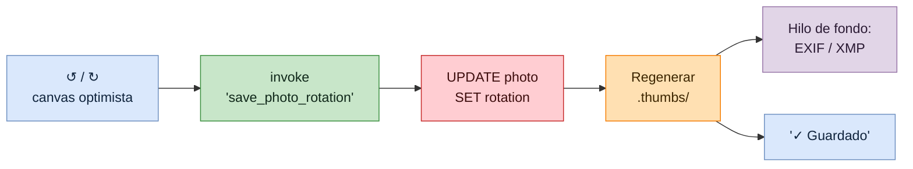
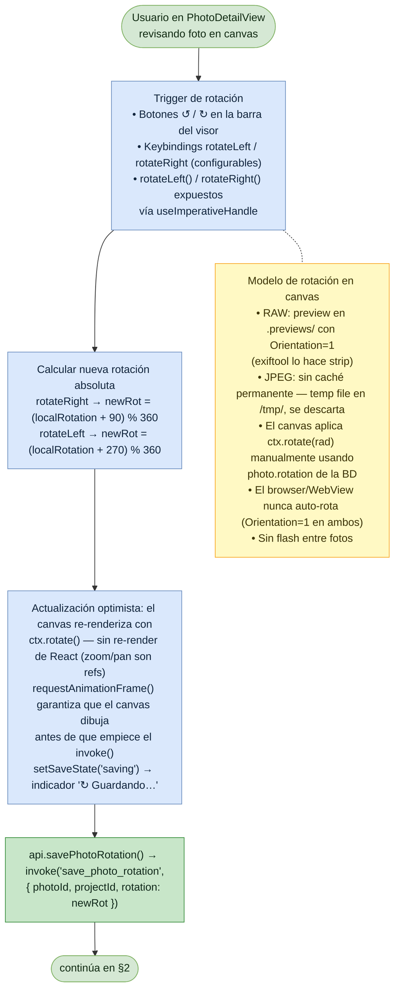
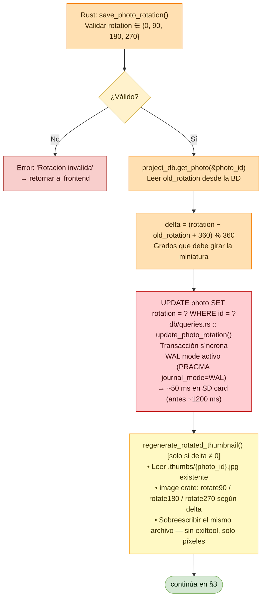
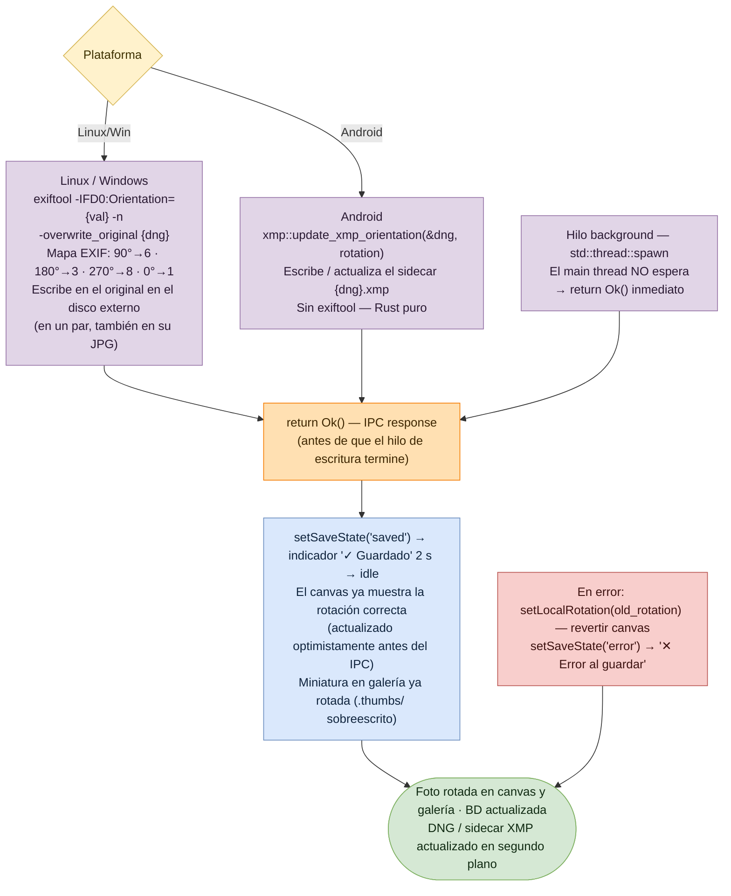

# Flujo: Rotación de imagen

Lumik Desktop · Linux · Windows · Android

La rotación se aplica primero en el canvas (optimista, sin re-render de React), se persiste en
`project.db`, se regenera la miniatura, y la escritura al archivo original ocurre en un hilo de
fondo que el comando **no espera**.

## Vista general

## 1. Disparo y actualización optimista (frontend)

## 2. Validación, base de datos y miniatura (backend)

## 3. Escritura al archivo (hilo de fondo) y respuesta

La escritura al RAW original corre en `std::thread::spawn`. El hilo principal **no espera**:
retorna `Ok()` de inmediato.

## Notas

| Punto | Detalle |
|-------|---------|
| `rotation` es absoluta | La BD guarda 0/90/180/270. `delta` solo se usa para saber cuánto girar la miniatura existente. |
| Nadie auto-rota | Tanto el preview RAW como el temp JPEG se escriben con `Orientation=1`, así que el canvas es la única fuente de rotación visible. |
| Miniatura por píxeles | `.thumbs/` se reescribe girando los píxeles, sin tocar EXIF. |
| Escritura asíncrona | Si falla la escritura al DNG/XMP, la BD y la UI ya quedaron actualizadas; el error no vuelve al frontend. |
| Mapa EXIF | 0°→1, 90°→6, 180°→3, 270°→8. |
| Pares RAW+JPG | `RotatePhoto` devuelve los dos archivos y la escritura asíncrona orienta ambos; la miniatura se gira una vez. |

## Archivos de código

| Fase | Archivos |
|------|----------|
| Disparo (§1) | `src/pages/Project/PhotoDetail/PhotoDetailView.tsx` — `rotateLeft()`, `rotateRight()`, `useImperativeHandle`, `PhotoViewer`; canvas `ctx.rotate(rad)` |
| Atajos (§1) | `src/lib/hooks.ts` — `DEFAULT_KEYBINDINGS`: `photo_detail.rotateLeft` / `rotateRight` |
| IPC (§1) | `src/lib/api.ts` — `savePhotoRotation(photoId, projectId, rotation)` |
| Comando (§2) | `src-tauri/src/commands.rs` — `save_photo_rotation()` (~L606), `regenerate_rotated_thumbnail()` (~L572), `read_exif_rotation()` (~L487) |
| Query (§2) | `src-tauri/src/db/queries.rs` — `update_photo_rotation()`, `UPDATE photo SET rotation` |
| Android (§3) | `src-tauri/src/import/xmp.rs` — `update_xmp_orientation()`, sidecar `{dng}.xmp` en Rust puro |
