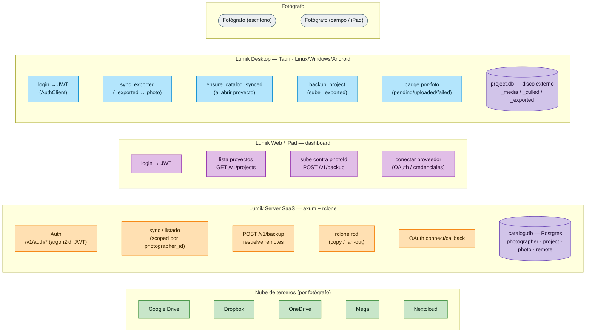
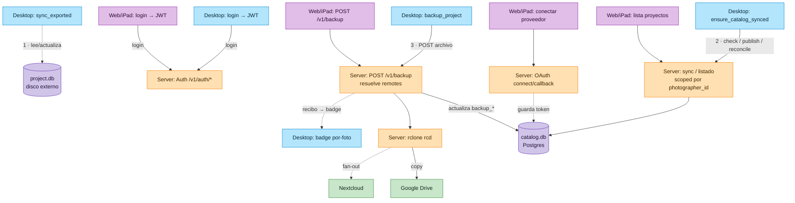

# WIP · Panorama — Respaldo de `_exported` a la nube (SaaS multi-tenant)

> **Estado: WIP.** Diseño propuesto, aún no implementado.

Mapa del subsistema completo de respaldo. Cada flujo de detalle tiene su propio documento:

- [Login / cuenta](wip-flujo-login-cuenta.md)
- [Conectar proveedor](wip-flujo-conectar-proveedor.md)
- [`ensure_catalog_synced`](wip-flujo-sync-catalogo.md)
- [Respaldar `_exported` (desktop)](wip-flujo-respaldar-exported.md)
- [Respaldo desde iPad/web](wip-flujo-respaldo-ipad.md)

## 1. Componentes por capa

## 2. Rutas del flujo (numeradas)

## Notas

| Punto | Detalle |
|-------|---------|
| Multi-tenant | Todo endpoint de listado o sync va *scoped* por `photographer_id`, siempre tomado del JWT. |
| Qué se respalda | Solo `_exported/` (los JPG entregables), no los RAW de `_media/`. |
| Fan-out | Un `POST /v1/backup` puede copiar a varios remotes a la vez vía `rclone rcd`. |
| Remotes por fotógrafo | La tabla `remote` de `catalog.db` guarda un token cifrado por fotógrafo y proveedor. |
| Dos bases | `project.db` (SQLite, en el disco externo, junto a las fotos) y `catalog.db` (Postgres, en el server). |
