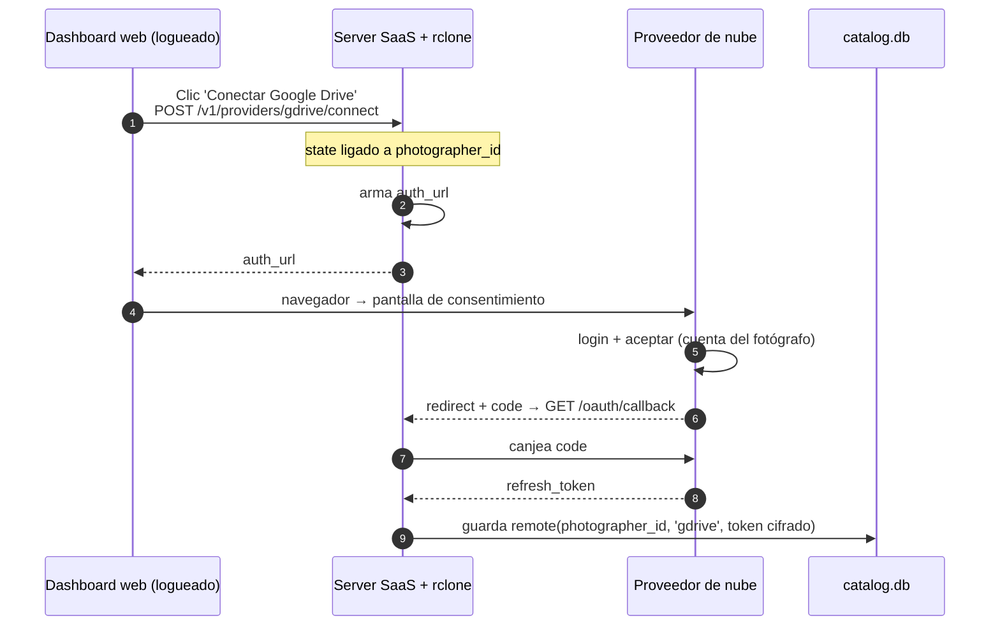
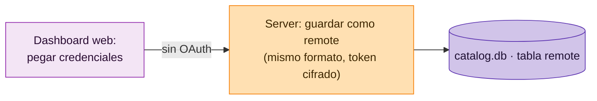

# WIP · Flujo: Conectar proveedor de nube (por fotógrafo)

> **Estado: WIP.** Diseño propuesto, aún no implementado.

Cada fotógrafo conecta sus propias cuentas de nube. La app OAuth (`client_id` / `client_secret`)
es **una sola, de Lumik, y vive en el server**; el `refresh_token` resultante es **por fotógrafo**
y se guarda cifrado.

## Camino OAuth (Google Drive, Dropbox, OneDrive)

## Camino sin OAuth (Mega, Nextcloud)

## Notas

| Punto | Detalle |
|-------|---------|
| App OAuth | `client_id` / `client_secret` son de Lumik, uno solo, en el server. El fotógrafo nunca los ve. |
| Token por fotógrafo | El `refresh_token` resultante es por fotógrafo y se guarda **cifrado** en `catalog.db`. |
| `state` | Va ligado al `photographer_id` para amarrar el callback al fotógrafo correcto. |
| Proveedores sin OAuth | Mega y Nextcloud se conectan pegando credenciales y desembocan en el mismo registro `remote`. |
