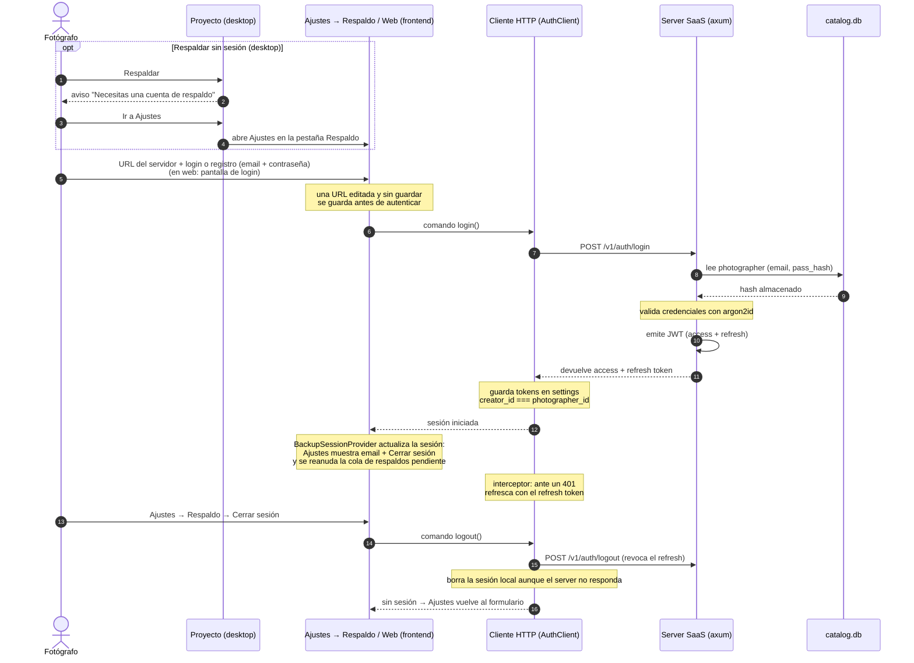

# WIP · Flujo: Login / Cuenta de fotógrafo (SaaS)

> **Estado: WIP.** Diseño propuesto, aún no implementado.

Autenticación del fotógrafo contra el server SaaS. La clave del diseño es que **hay una sola
entidad `photographer`**: el `creator_id` local y el `photographer_id` del server son la misma
identidad.

## Notas

| Punto | Detalle |
|-------|---------|
| Identidad única | Una sola entidad `photographer`. El server es dueño de `email` y `pass_hash`; el id local (`creator_id`) y el `photographer_id` del server son la MISMA identidad. |
| Hashing | `argon2id` en el server. |
| Renovación | El `AuthClient` lleva un interceptor que, ante un `401`, renueva con el refresh token de forma transparente. |
| Almacenamiento | Los tokens quedan en los *settings* locales de la app. |
| Dónde se gestiona (desktop) | URL del servidor, login, registro y logout en Ajustes → Respaldo. Pulsar Respaldar en un proyecto sin sesión muestra un aviso con "Ir a Ajustes", que abre esa pestaña. La barra lateral no muestra datos de la cuenta. |
| Cola pendiente | La cola de respaldos se reanuda la primera vez que hay sesión en la ejecución (al arrancar o al iniciar sesión); sin sesión no se intenta subir nada. |
