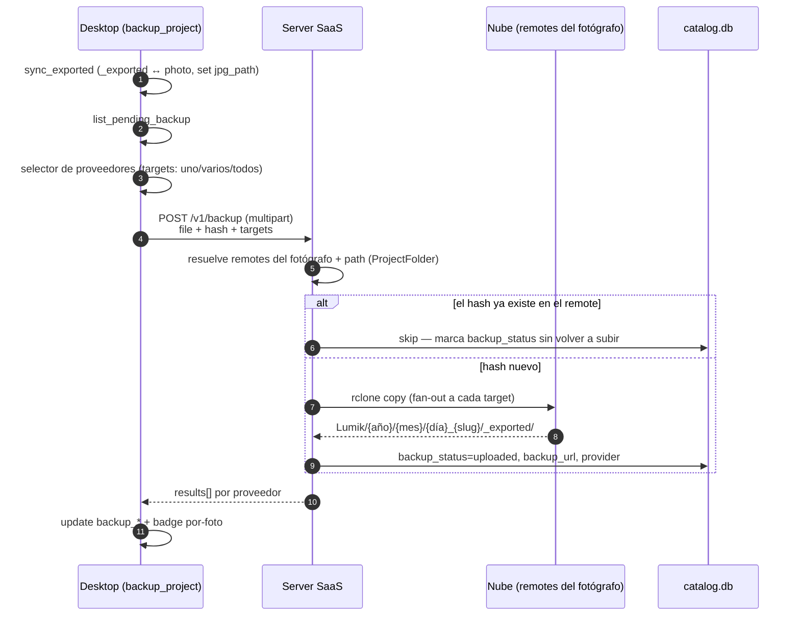

# WIP · Flujo: Respaldar `_exported` (desktop)

> **Estado: WIP.** Diseño propuesto, aún no implementado.

Sube los JPG de `_exported/` a los remotes del fotógrafo, con fan-out a varios proveedores en
una sola petición y deduplicación por hash.

## Notas

| Punto | Detalle |
|-------|---------|
| Estado por-foto | `backup_status = uploaded` solo cuando **todos** los targets subieron; `failed` si alguno falla. El detalle viene en `results[]`, un entry por proveedor. |
| Deduplicación | Si el hash ya está en el remote, se omite la subida y solo se actualiza el estado. |
| Ruta en la nube | `Lumik/{año}/{mes}/{día}_{slug}/_exported/`, espejo de la estructura local. |
| Precondición | El catálogo debe existir: ver [`ensure_catalog_synced`](wip-flujo-sync-catalogo.md). |
