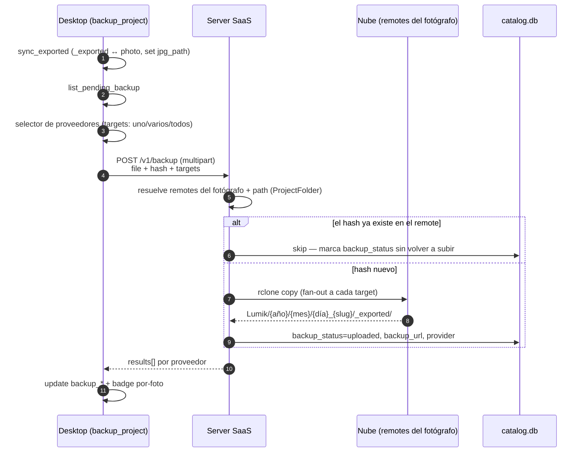
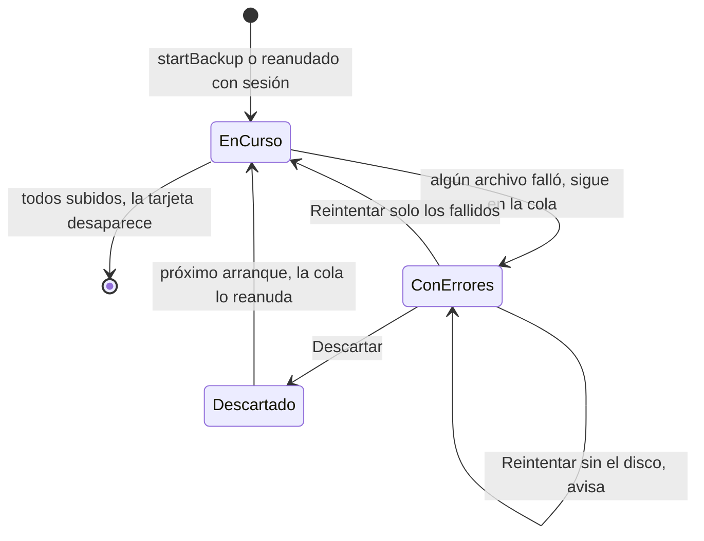
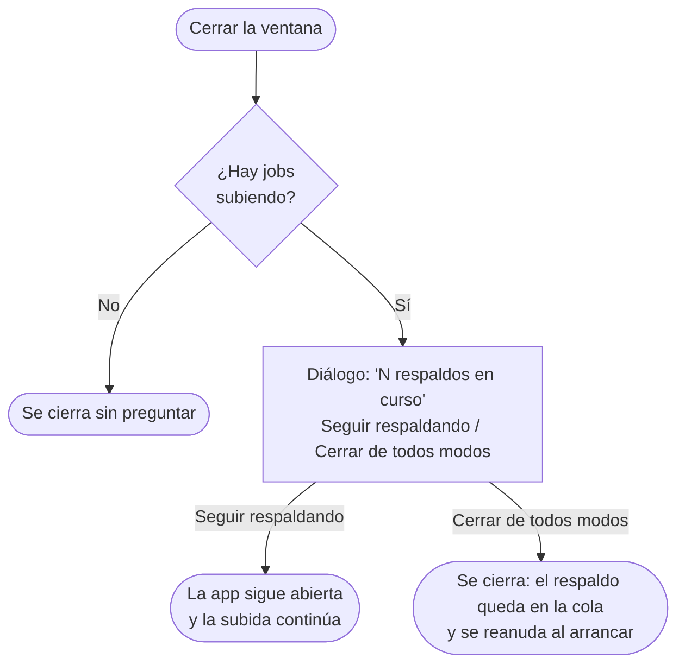
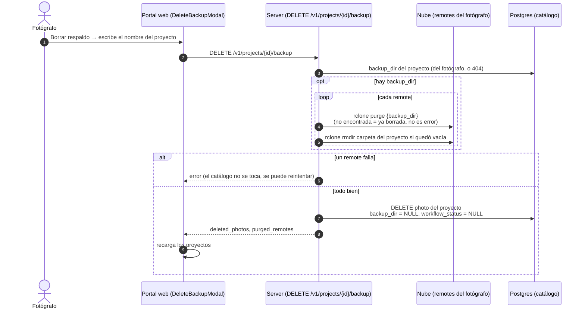

# WIP · Flujo: Respaldar `_exported` (desktop)

> **Estado: WIP.** Diseño propuesto, aún no implementado.

Sube los JPG de `_exported/` a los remotes del fotógrafo, con fan-out a varios proveedores en
una sola petición y deduplicación por hash.

## Notas

| Punto | Detalle |
|-------|---------|
| Estado por-foto | `backup_status = uploaded` solo cuando **todos** los targets subieron; `failed` si alguno falla. El detalle viene en `results[]`, un entry por proveedor. |
| Deduplicación | Si el hash ya está en el remote, se omite la subida y solo se actualiza el estado. |
| Ruta en la nube | `Lumik/{año}/{mes}/{día}_{slug}/_exported/`, espejo de la estructura local. |
| Precondición | El catálogo debe existir: ver [`ensure_catalog_synced`](wip-flujo-sync-catalogo.md). |

## Seguimiento desde la barra lateral

El respaldo corre en `BackupProvider` (a nivel de app), así que se sigue desde cualquier pantalla.
Cada job aparece como una tarjeta en la sección **Respaldos** de la barra lateral
(`nombre del proyecto · subidos/total`). La sección solo se muestra mientras hay jobs (en curso o
con errores), sin depender de la sesión. Al pulsarla se abre el modal de detalle archivo por
archivo, montado una sola vez en `BackupModalHost`, igual que desde el proyecto.

| Punto | Detalle |
|-------|---------|
| Barra lateral | Respaldos aparece solo con jobs y se oculta al terminar el último. Respaldos y Almacenamiento se pueden colapsar (estado en `global_db`). Colapsada, Respaldos muestra `en curso · subidos/total` o cuántos terminaron con errores. Se expande sola al lanzar un respaldo, no al reanudarlo. |
| Sin sesión | Respaldar muestra un aviso con "Ir a Ajustes" (pestaña Respaldo) en lugar del modal; la cola no se reanuda hasta iniciar sesión (ver [login](wip-flujo-login-cuenta.md)). |
| Confirmación al cerrar | `onCloseRequested` en el frontend + `ask` del plugin de diálogo; cerrar usa `destroy()` (`core:window:allow-destroy`). |

## Borrar el respaldo del proyecto

Solo desde el **portal web** (menú de la tarjeta → "Borrar respaldo", en proyectos con fotos
subidas), nunca desde la app de escritorio, para no borrar un respaldo por error. Hay que escribir
el nombre del proyecto para confirmar. Borra la carpeta del proyecto en la nube y sus fotos del
catálogo; el disco del fotógrafo no se toca y el siguiente respaldo sube todo de nuevo.

| Punto | Detalle |
|-------|---------|
| Para qué | Volver a subir un proyecto cuyo respaldo se borró a mano en la nube: el catálogo lo seguía dando por subido. |
| Mega | `rclone purge` manda los archivos a la papelera del proveedor (sin `hard_delete`). |
| Proyecto en el catálogo | Se queda (el portal lo muestra sin fotos); solo se borran sus fotos, el ancla `backup_dir` y el estado fijado. |
| Desktop | No cambia su estado local: el proyecto sigue mostrando sus proveedores hasta el siguiente respaldo. El modal de respaldo consulta el catálogo, así que ofrece subir todo de nuevo. |
| Código | Server `backup::handlers::delete_backup`, `Rclone::purge`/`rmdir`; web `components/DeleteBackupModal.tsx`, `pages/Dashboard.tsx`, `backupApi.deleteBackup`; `ProjectCard.onDeleteBackup` en `@lumik/ui`. |
