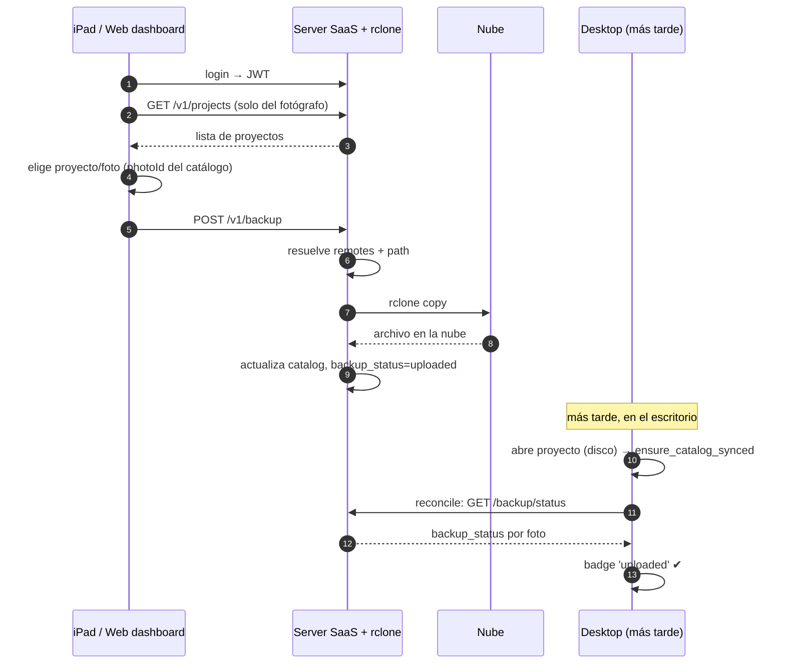

# WIP · Flujo: Respaldo desde iPad/web + reconciliación

> **Estado: WIP.** Diseño propuesto, aún no implementado.

El fotógrafo sube desde campo contra fotos **ya publicadas** en el catálogo por la desktop.
Más tarde, al abrir el proyecto en la desktop, el estado se reconcilia y aparece el badge.

## Notas

| Punto | Detalle |
|-------|---------|
| Alcance del MVP | El iPad **solo** sube contra fotos ya publicadas por la desktop (usa el `photoId` del catálogo). Las fotos que nazcan solo en el iPad quedan fuera del MVP. |
| Reconciliación | El badge en desktop no es inmediato: aparece al abrir el proyecto y correr [`ensure_catalog_synced`](wip-flujo-sync-catalogo.md) + `GET /backup/status`. |
| Scoping | `GET /v1/projects` devuelve solo los proyectos del fotógrafo del JWT. |
