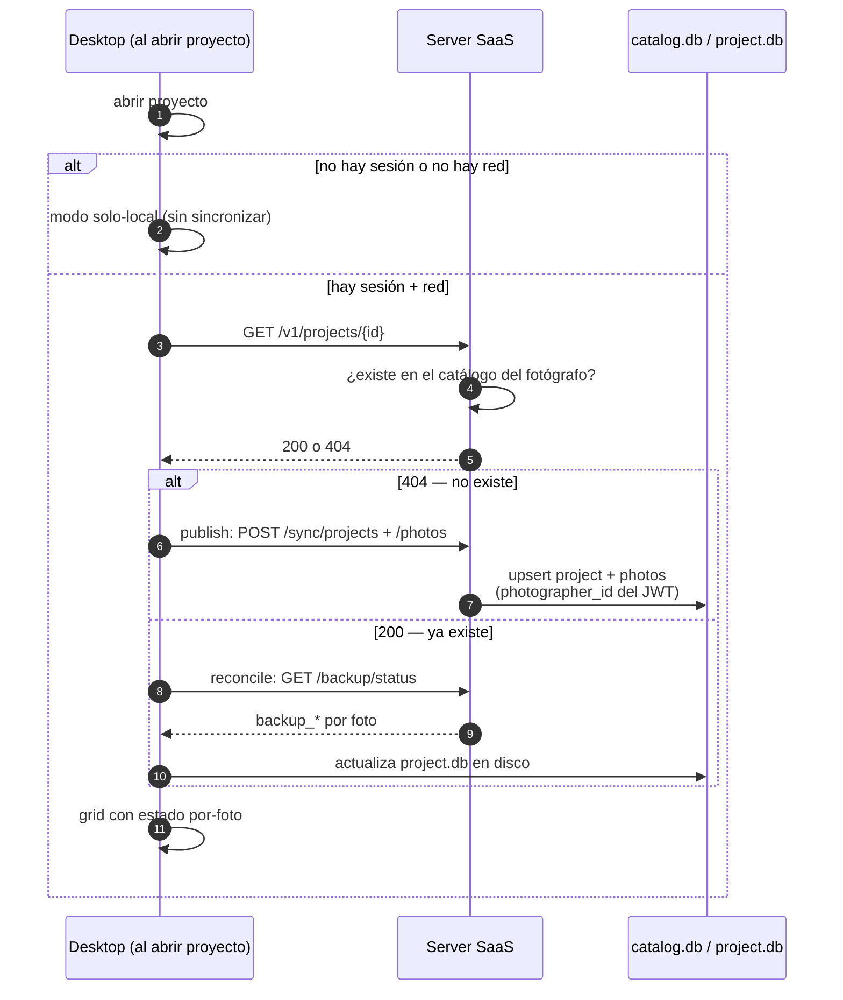

# WIP · Flujo: `ensure_catalog_synced` (al abrir un proyecto)

> **Estado: WIP.** Diseño propuesto, aún no implementado.

Operación **idempotente** que corre al abrir un proyecto. Garantiza la precondición de que el
catálogo exista en el server antes de poder respaldar desde cualquier dispositivo.

## Notas

| Punto | Detalle |
|-------|---------|
| Idempotente | Se puede llamar en cada apertura de proyecto sin efectos duplicados. |
| Precondición | Es lo que habilita respaldar desde iPad/web: el catálogo tiene que existir primero. |
| Scoping | El `photographer_id` siempre sale del JWT, nunca del cliente. |
| Sin red | Degrada a modo solo-local; no bloquea la apertura del proyecto. |
| Dos direcciones | `publish` sube el catálogo (404); `reconcile` baja los `backup_*` y actualiza `project.db` en disco (200). |
